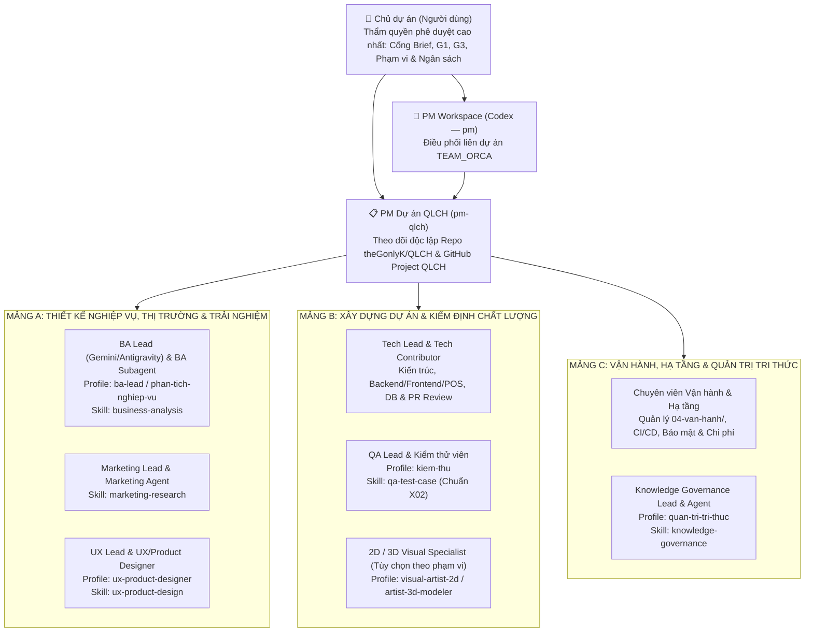

# Đội ngũ Agent Chuyên trách & Cơ chế Phối hợp Dự án `QLCH`

- **Dự án:** Quản lý hệ thống cửa hàng (`QLCH`)
- **Căn cứ:** `3.DOC_AI/quan-tri/RULES_CORE.md`, `3.DOC_AI/quan-tri/MO_HINH_VAN_HANH.md`, Quyết định `QLCH-D001` (`01-quan-ly/DECISIONS.md`)
- **Ngày thiết lập:** `2026-11-14`
- **Trạng thái:** **`Đã sẵn sàng vận hành (Ready to Follow)`**

---

## 1. Sơ đồ Tổ chức Đội ngũ Agent Theo dõi Dự án `QLCH`

---

## 2. Danh sách Chi tiết Đội ngũ Agent, Profile, Skill & Trách nhiệm trong `QLCH`

| STT | Mảng | Vai trò trong `QLCH` | Agent Profile / Công cụ | Skill chuẩn áp dụng (`3.DOC_AI/skills/`) | Phạm vi trách nhiệm & Đầu ra chính tại `4.Du_an/QLCH` |
| :---: | :---: | :--- | :--- | :--- | :--- |
| **1** | **Điều phối** | **PM Dự án QLCH** (`PM Lead` & `PM Agent`) | `.claude/agents/pm-qlch.md` & Codex PM | `pm-operations/SKILL.md` | • Quản lý độc lập kế hoạch, tiến độ, phụ thuộc và rủi ro của `QLCH`. • Chủ động tạo 100% Task dưới dạng GitHub Issue trong repo `theGonlyK/QLCH` gắn vào GitHub Project `QLCH` kèm đầy đủ thông tin ngay khi chốt (`RULES_CORE.md` Mục 8). • Điều phối ưu tiên động & phân bổ Agent trống theo `RULES_CORE.md` Mục 10; cập nhật `4.Du_an/QLCH/HANDOVER.md`. |
| **2** | **Mảng A** | **BA Lead & BA Agent** (Phân tích nghiệp vụ) | `.agents/agents/ba-lead.md` `.claude/agents/phan-tich-nghiep-vu.md` | `business-analysis/SKILL.md` | • Làm rõ bài toán chuỗi cửa hàng, quy trình Bán hàng (POS), Tồn kho đa chi nhánh, Mua hàng/Nhà cung cấp, Nhân sự/Ca, Công nợ & Báo cáo. • Biên soạn và quản lý `02-nghiep-vu/REQUIREMENTS.md`, `GLOSSARY.md`, `BRD.md`, `SRS.md`, `USE_CASES.md`, `FUNCTIONAL_BREAKDOWN_AND_RBAC.md`, `MA_TRAN_TRUY_VET_P1.md`. |
| **3** | **Phối hợp xuyên mảng** | **Marketing Lead & Marketing Agent** | Subagent theo vai trò Marketing | `marketing-research/SKILL.md` | • Khảo sát thị trường phần mềm quản lý cửa hàng/POS (KiotViet, Sapo, Haravan, PosApp, Odoo...), phân tích đối thủ và xu hướng. • Tuyển chọn biểu mẫu hóa đơn bán lẻ, phiếu nhập/xuất/kiểm kho vào `2.Tai_lieu_tham_khao/3.Tai_lieu_nghiep_vu/` và báo cáo vào `5.Tai_lieu_marketing/`. |
| **4** | **Mảng A** | **UX Lead & UX/Product Designer** | `.claude/agents/ux-product-designer.md` | `ux-product-design/SKILL.md` | • Thiết kế User Flow, Information Architecture, Wireframe và Prototype cho các màn hình Quầy thu ngân (POS), Quản lý kho, Quản lý chuỗi chi nhánh trên Web/Tablet/Mobile. |
| **5** | **Mảng B** | **Tech Lead & Tech Contributor (Dev)** | Subagent Kiến trúc/Lập trình & Cộng tác viên GitHub | Chuẩn kỹ thuật dự án (`03-ky-thuat/`, `04-van-hanh/`) | • Đánh giá và đề xuất kiến trúc (`03-ky-thuat/TECH_PROFILE.md`), cơ chế đồng bộ tồn kho thời gian thực, Offline POS, tích hợp máy in bill/mã vạch/VietQR cục bộ. • Thực thi code trên nhánh riêng gắn mã `#Issue` của `theGonlyK/QLCH`; review PR trước khi merge. |
| **6** | **Mảng B** | **QA Lead & Kiểm thử viên (`QA Agent`)** | `.claude/agents/kiem-thu.md` | `qa-test-case/SKILL.md` | • Thiết kế kịch bản kiểm thử theo chuẩn `X02`, kiểm thử độ chính xác công thức tính tiền/chiết khấu/thuế/tồn kho đa chi nhánh và phân quyền RBAC. • Quản lý kế hoạch kiểm thử và nghiệm thu môi trường tại `04-van-hanh/`. |
| **7** | **Mảng B** | **2D Visual Artist** | `.claude/agents/visual-artist-2d.md` | `visual-artist-2d/SKILL.md` | • **Trạng thái:** **`Đã kích hoạt (QLCH-D002)`**. • Thiết kế sơ đồ mặt bằng trực quan 2D cho vị trí kệ/ô chứa kho bãi (`Zone/Rack/Bin`) ở `P1` và sơ đồ quầy cửa hàng / bản đồ theo dõi tuyến vận chuyển ở `P2` (chưa dùng mô phỏng 3D). |
| **8** | **Mảng C** | **Quản lý Vận hành & Hạ tầng** | `Tech Lead` phối hợp `PM Dự án QLCH` | `pm-operations/SKILL.md` & chuẩn `04-van-hanh/` | • Thiết lập và quản lý chuẩn hạ tầng, bảo mật đa cửa hàng, sao lưu dữ liệu, kiểm soát chi phí và quy trình phát hành/rollback tại `04-van-hanh/QUALITY_AND_RELEASE.md`. |
| **9** | **Độc lập** | **Quản trị Tri thức (`Knowledge Governance`)** | `.claude/agents/quan-tri-tri-thuc.md` | `knowledge-governance/SKILL.md` | • Đánh giá chất lượng quy trình và tài liệu cuối mỗi Sprint của `QLCH`, cập nhật `04-van-hanh/IMPROVEMENTS.md` và đề xuất rút trích tri thức dùng chung sang `3.DOC_AI/` sau khi Chủ dự án duyệt. |

---

## 3. Quy tắc Vận hành Bắt buộc cho Đội ngũ Agent `QLCH`

1. **Cách ly ngữ cảnh & Repository tuyệt đối:**
   - Mọi tài liệu riêng, quyết định (`QLCH-Dxxx`), mã nguồn và cấu hình của dự án `QLCH` chỉ được lưu trong `TEAM_ORCA/4.Du_an/QLCH` (Git repo `theGonlyK/QLCH`).
   - Không lấy giả định nghiệp vụ của `QLNT` áp sang `QLCH` nếu chưa được Chủ dự án xác nhận.
2. **Quản lý 100% Task trên `theGonlyK/QLCH` & GitHub Project `QLCH` (`RULES_CORE.md` Mục 8):**
   - Toàn bộ công việc thuộc dự án `QLCH` phải được tạo thành **GitHub Issue thực thể trong `theGonlyK/QLCH`** và gắn vào **GitHub Project `QLCH`** (tuyệt đối không tạo `DraftIssue` không có repo).
   - Khi một quyết định, cổng hoặc kế hoạch được chốt, `PM Dự án QLCH` chủ động khởi tạo đầy đủ các Task với trọn bộ thông tin (Mục tiêu, Phụ thuộc, Độ ưu tiên theo Quy tắc 10, Ràng buộc kỹ thuật/chi phí, Tài liệu tham chiếu, DoD).
   - Mỗi khi hoàn thành task, bắt buộc ghi nhật ký kết quả + link file/commit vào `Body`/Comment và chuyển trạng thái `Done` / `CLOSED` ngay lập tức.
3. **Điều phối theo Độ ưu tiên động & Tận dụng Agent trống (`RULES_CORE.md` Mục 10):**
   - Xử lý task theo mức độ ưu tiên (`Cao` $\rightarrow$ `Trung bình` $\rightarrow$ `Thấp`).
   - Tự động nâng độ ưu tiên (`Dynamic Priority Boost`) nếu phía sau task đó có task cùng/cao hơn độ ưu tiên đang phải chờ do phụ thuộc.
   - Các task độc lập (`0` phụ thuộc hoặc đã đủ đầu vào) được giao thực hiện ngay khi có Agent trống.
