# Phân rã Chức năng & Ma trận Phân quyền (RBAC) theo 04 Phân hệ Tách biệt — QLCH

- **Mã dự án:** `QLCH` — Hệ thống Quản lý Chuỗi Cửa hàng, Kho bãi & Thương mại Điện tử Hợp nhất
- **Căn cứ quyết định:** [`QLCH-D002`, `QLCH-D003`](file:///Users/uni/orca/workspaces/QLCH/c-ng-brief-qlch-ba-01-ba-p0-ch-n-ng-g-ng-l-m-r-y/01-quan-ly/DECISIONS.md) (`01-quan-ly/DECISIONS.md`), [`02-nghiep-vu/REQUIREMENTS.md`](file:///Users/uni/orca/workspaces/QLCH/c-ng-brief-qlch-ba-01-ba-p0-ch-n-ng-g-ng-l-m-r-y/02-nghiep-vu/REQUIREMENTS.md), [`02-nghiep-vu/USE_CASES.md`](file:///Users/uni/orca/workspaces/QLCH/c-ng-brief-qlch-ba-01-ba-p0-ch-n-ng-g-ng-l-m-r-y/02-nghiep-vu/USE_CASES.md)
- **Ngày cập nhật:** `2026-11-14`
- **Người thực hiện:** `BA Lead` (Kỹ năng `business-analysis/SKILL.md`)

---

## 1. Tổng quan Kiến trúc 04 Phân hệ Tách biệt (`QLCH-D003`)

Theo chỉ đạo của Chủ dự án (`QLCH-D003`), toàn bộ hệ thống `QLCH` được tách biệt rõ ràng thành **04 Phân hệ độc lập về mặt cổng giao diện/ứng dụng (`Multi-Portal`) và phạm vi phân quyền (`RBAC`)**, nhưng liên thông 100% dữ liệu thời gian thực trên một Cơ sở dữ liệu lõi (`PostgreSQL`):

```mermaid
flowchart TB
    subgraph SUB1["1. PHÂN HỆ QUẢN TRỊ ỨNG DỤNG (SYS-ADMIN — @qlch/admin-portal)"]
        A1["1.1. Quản trị Cơ cấu Tổ chức (Kho / Cửa hàng / Kênh Online)"]
        A2["1.2. Quản trị Tài khoản, Phân quyền RBAC 4 Phân hệ & PIN/OTP 2 lớp"]
        A3["1.3. Quản trị Master Data (Ngành hàng, SKU, Đa ĐVT, Giá trần, NCC)"]
        A4["1.4. Trung tâm Pháp lý 17 loại Giấy phép (ANTT/PCCC/VLNCN/Pháo)"]
        A5["1.5. Báo cáo Quản trị Toàn chuỗi & Nhật ký Kiểm toán (Audit Logs)"]
    end

    subgraph SUB2["2. PHÂN HỆ QUẢN LÝ KHO BÃI (WMS — @qlch/wms-portal)"]
        W1["2.1. Quản lý Đa kho (Hub/DC, Kho VLNCN/Pháo, Kho Cách ly) & Sơ đồ 2D (Zone/Rack/Bin)"]
        W2["2.2. Kiểm soát Trần Thuốc nổ Quy đổi (NEQ Hard-Lock) & Cách ly Hàng Kỵ nhau"]
        W3["2.3. Nghiệp vụ Nhập kho (BM-KHO-01), Putaway & Tính Giá vốn MAC"]
        W4["2.4. Nghiệp vụ Xuất kho (BM-KHO-02), Picking FEFO/FIFO & Xuất hủy An toàn"]
        W5["2.5. Điều chuyển Liên kho 2 bước (BM-KHO-03 In-Transit), Giấy phép VC & Kẹp chì"]
        W6["2.6. Kiểm kê Kho Mù bằng Mã vạch (BM-KHO-04) & Cân bằng kho 2 lớp"]
        W7["2.7. Thẻ kho Bất biến, Báo cáo NXT, Sổ Công an C06 & Offline-first WMS"]
    end

    subgraph SUB3["3. PHÂN HỆ QUẢN LÝ CỬA HÀNG (STORE & POS — @qlch/store-pos-portal)"]
        S1["3.1. Quản lý Sơ đồ 2D Quầy/Kệ Cửa hàng & Định mức Trưng bày An toàn"]
        S2["3.2. Yêu cầu Bổ sung Hàng & Quét Nhận hàng Điều chuyển từ WMS"]
        S3["3.3. Quản lý Ca Thu ngân, Thu/Chi tại quầy & Kết ca Mù (BM-POS-03)"]
        S4["3.4. Bán hàng Quầy POS Tốc độ cao (<15s), Hold Bill, VietQR & In bill K80/K57 (BM-POS-01)"]
        S5["3.5. Bán hàng Đặc thù tại quầy: Định danh CCCD 12 số (Pháo Z121) & Khóa Giá trần"]
        S6["3.6. Bàn giao Đơn Click & Collect và Đổi/Trả hàng tại quầy (BM-POS-02)"]
    end

    subgraph SUB4["4. PHÂN HỆ CỔNG THƯƠNG MẠI ĐIỆN TỬ ONLINE (ECOM — @qlch/ecom-portal)"]
        E1["4.1. Cổng Trưng bày Online (Storefront B2C & Portal B2B) & Đồng bộ Tồn Khả dụng"]
        E2["4.2. Bộ lọc Pháp lý Tự động (Ẩn VLNCN trên B2C, Mở theo Giấy phép trên B2B)"]
        E3["4.3. Giỏ hàng, Đặt hàng Online (Click & Collect / Giao tận nơi) & Định danh CCCD 12 số"]
        E4["4.4. Thanh toán VietQR Cục bộ ($0 First) / COD & Khóa Tồn giữ chỗ (Reserved)"]
        E5["4.5. Điều phối Thực hiện Đơn Online (Fulfillment) & Giao vận Đội xe (TMS / COD)"]
    end

    SUB1 ==>|"Đồng bộ Master Data, RBAC & Khóa Pháp lý"| SUB2
    SUB1 ==>|"Đồng bộ Giá bán, Giá trần & Phân quyền"| SUB3
    SUB1 ==>|"Đồng bộ Catalog & Quy tắc Pháp lý"| SUB4
    SUB2 <==>|"Điều chuyển In-Transit & Trừ tồn POS"| SUB3
    SUB2 <==>|"Đồng bộ Available Stock & Lệnh Picking"| SUB4
    SUB3 <==>|"Nhận hàng tại quầy (Click & Collect)"| SUB4
```

---

## 2. Bảng Phân rã Chức năng Chi tiết theo 04 Phân hệ (`Functional Breakdown`)

### 2.1. Phân hệ 1 — Quản trị Ứng dụng (`SYS-ADMIN` — `@qlch/admin-portal`)

| Mã Module | Tên Chức năng con | Mô tả Nghiệp vụ & Quy tắc Kiểm soát | Giai đoạn | Use Case / Yêu cầu |
| :---: | :--- | :--- | :---: | :---: |
| **`ADM-01`** | Quản trị Cơ cấu Tổ chức Chuỗi | Khởi tạo và cấu hình các đơn vị trong chuỗi: `Kho tổng (Hub/DC)`, `Kho chuyên dụng (VLNCN/Pháo)`, `Kho cách ly (Quarantine)`, `Cửa hàng bán lẻ (Store)` và `Cổng TMĐT Online`. | **`P1 MVP`** | `UC-ADM-01` / `FR-ADM-01` |
| **`ADM-02`** | Quản trị Tài khoản, Phân quyền `RBAC` 4 Phân hệ & Xác thực `PIN/OTP` | Cấp phát tài khoản nhân sự, gán quyền truy cập tách biệt theo 4 phân hệ và giới hạn phạm vi dữ liệu theo từng điểm Kho/Cửa hàng (`Location-scoped RBAC`); cấu hình mã `PIN/TOTP` 2 lớp cục bộ cho cấp quản lý. | **`P1 MVP`** | `UC-ADM-01` / `FR-ADM-01` |
| **`ADM-03`** | Quản trị Danh mục Hàng hóa Dùng chung (`Master Data: SKU`) | Quản lý tập trung Ngành hàng, Thương hiệu, `SKU`, Mã vạch, Đa đơn vị tính (`Base UoM` & `Multi-UoM`), Giá vốn `MAC`, **Giá bán lẻ trần (`Ceiling Price` cho Pháo hoa `Z121`)** và thuộc tính Hàng cháy nổ (`Mã UN`, `Unit NEQ/NEW`, Nhóm kỵ lưu trữ). | **`P1 MVP`** | `UC-WMS-02` / `FR-ADM-02` |
| **`ADM-04`** | Trung tâm Quản trị 17 loại Giấy phép Pháp lý (`Compliance Registry`) | Quản lý hồ sơ, số giấy phép, ngày hết hạn và định mức `NEQ` của 17 loại Giấy phép/GCN/Chứng chỉ (`ANTT C06`, `PCCC C07`, `VLNCN`, `Pháo Z121`, `Đăng kiểm xe Loại 1`, `Chứng chỉ nhân sự`); cảnh báo trước `30-60 ngày` và tự động khóa quyền thực thi (`Hard Lock`) khi hết hạn. | **`P1 MVP`** | `UC-WMS-03` / `FR-ADM-03` |
| **`ADM-05`** | Nhật ký Kiểm toán Toàn hệ thống (`System Audit Logs`) | Ghi nhận bất biến (`Append-only`) mọi thao tác cấu hình, sửa giá, duyệt kiểm kê/xuất hủy kèm chữ ký xác thực 2 lớp trên cả 4 phân hệ. | **`P1 MVP`** | `UC-ADM-01` / `FR-ADM-01` |

---

### 2.2. Phân hệ 2 — Quản lý Kho bãi (`WMS` — `@qlch/wms-portal`)

| Mã Module | Tên Chức năng con | Mô tả Nghiệp vụ & Quy tắc Kiểm soát | Giai đoạn | Use Case / Yêu cầu |
| :---: | :--- | :--- | :---: | :---: |
| **`WMS-01`** | Cấu trúc Vị trí Kho (`Zone/Rack/Bin`) & Sơ đồ Kho Trực quan 2D | Thiết kế mặt bằng kho 2D, cấu hình phân cấp `Khu vực (Zone) -> Kệ (Rack) -> Ô chứa (Bin)`, in tem mã vạch vị trí `Bin`, hiển thị trực quan mật độ lấp đầy và thanh tải trọng thuốc nổ **`% NEQ / Max NEQ`**. | **`P1 MVP`** | `UC-WMS-01` / `FR-WMS-01..02` |
| **`WMS-02`** | Nhập kho Hàng hóa (`Inbound`), Cất hàng (`Putaway`) & Khóa chặn Trần `NEQ` | Lập Phiếu Nhập kho chuẩn **`BM-KHO-01` (`Mẫu số 01-VT`)**, tách `SL Chứng từ` vs `SL Thực nhập`, quét mã cất hàng vào `Bin`, tự động tính giá vốn `MAC`, **khóa chặn cứng nếu vượt trần `Max NEQ`** và **cấm xếp chung `Kíp nổ` + `Thuốc nổ`**. | **`P1 MVP`** | `UC-WMS-04` / `FR-WMS-04, 08` |
| **`WMS-03`** | Xuất kho Hàng hóa (`Outbound`), Soạn hàng `FEFO/FIFO` & Xuất hủy | Lập Phiếu Xuất kho chuẩn **`BM-KHO-02` (`Mẫu số 02-VT`)**, giữ chỗ tồn kho (`Reserved`), chỉ định lấy hàng theo lô hạn gần nhất (`FEFO/FIFO`) trên sơ đồ 2D, kiểm tra Giấy phép B2B `VLNCN` và ký duyệt 2 lớp `PIN/OTP`. | **`P1 MVP`** | `UC-WMS-05` / `FR-WMS-04, 08` |
| **`WMS-04`** | Điều chuyển Liên kho 2 bước (`In-Transit Stock Transfer`) | Lập Phiếu Điều chuyển chuẩn **`BM-KHO-03`**: Bước 1 Kho xuất trừ tồn & chuyển sang `Tồn đang vận chuyển (In-Transit)` kèm Giấy phép VC `C06/PC07` + mã kẹp chì `Seal No`; Bước 2 Kho/Cửa hàng nhận đối chiếu kẹp chì & quét thực nhận. | **`P1 MVP`** | `UC-WMS-06` / `FR-WMS-05` |
| **`WMS-05`** | Kiểm kê Kho Mù bằng Mã vạch (`Blind Stocktake`) & Cân bằng kho | Chốt mốc `Snapshot`, ẩn tồn hệ thống (`Blind Count`), quét mã vạch cộng dồn `+1 (< 1s)`, phân loại 3 cột phẩm chất chuẩn **`BM-KHO-04` (`Mẫu số 05-VT`)** và duyệt cân bằng kho 2 lớp. | **`P1 MVP`** | `UC-WMS-07` / `FR-WMS-06` |
| **`WMS-06`** | Báo cáo Thẻ kho, `NXT`, Sổ Báo cáo Công an `C06` & `Offline-first` | Đối soát tồn kho 4 trạng thái (`On-hand`, `Reserved`, `Available`, `In-Transit`), trích xuất sổ báo cáo pháp lý nộp `C06`/Sở Công Thương và vận hành ngoại tuyến qua `IndexedDB`. | **`P1 MVP`** | `UC-WMS-08..09` / `FR-WMS-07`, `NFR-02` |

---

### 2.3. Phân hệ 3 — Quản lý Cửa hàng (`STORE & POS` — `@qlch/store-pos-portal`)

| Mã Module | Tên Chức năng con | Mô tả Nghiệp vụ & Quy tắc Kiểm soát | Giai đoạn | Use Case / Yêu cầu |
| :---: | :--- | :--- | :---: | :---: |
| **`STR-01`** | Sơ đồ 2D Quầy/Kệ Cửa hàng & Định mức Trưng bày An toàn | Quản lý bố cục 2D quầy/kệ trưng bày tại điểm bán, kiểm soát trần `Max NEQ` trưng bày an toàn tại cửa hàng Pháo hoa `Z121`, gửi yêu cầu xin hàng và quét nhận hàng điều chuyển từ `WMS`. | `P2` *(Định khung G1)* | `UC-STR-01` / `FR-STR-01` |
| **`STR-02`** | Quản lý Ca Thu ngân & Kết ca Mù (`Blind Shift Handover`) | Mở ca, ghi nhận thu/chi tiền mặt tại quầy, đóng ca mù (nhập bảng đếm tiền theo mệnh giá trước khi hiện số lý thuyết) và in biên bản bàn giao ca chuẩn **`BM-POS-03`**. | `P2` *(Định khung G1)* | `UC-POS-01` / `FR-POS-01` |
| **`STR-03`** | Bán hàng Quầy POS Tốc độ cao (`< 15s`) & In Hóa đơn Nhiệt `K80/K57` | Quét mã tính tiền tức thì, phím tắt `F1–F12`, tạm lưu nhiều đơn (`Hold Bill`), thanh toán kết hợp Tiền mặt + **VietQR động cục bộ (`$0 First`)**, in bill chuẩn **`BM-POS-01` (Nghị định `70/2025/NĐ-CP`)** và hoạt động `Offline POS`. | `P2` *(Định khung G1)* | `UC-POS-02` / `FR-POS-01` |
| **`STR-04`** | Bán hàng Đặc thù tại Quầy (`CCCD 12 số` Pháo `Z121` & Khóa Giá trần) | Bắt buộc nhập/quét QR thẻ **`CCCD 12 số` ($\ge 18$ tuổi), Họ tên, Địa chỉ** và khóa cứng giá trần niêm yết BQP khi bán lẻ Pháo hoa `Z121`; in hóa đơn kèm thông tin định danh để người mua lưu thông hợp pháp. | `P2` *(Định khung G1)* | `UC-POS-03` / `FR-POS-02` |
| **`STR-05`** | Bàn giao Đơn `Click & Collect` & Đổi/Trả hàng tại Quầy (`BM-POS-02`) | Đối chiếu CCCD gốc để bàn giao đơn khách đặt Online nhận tại quầy; xử lý đổi/trả hàng theo hóa đơn gốc **`BM-POS-02`**, tách `Kho Bán Hàng` vs `Kho Cách ly An toàn (Quarantine)`. | `P2` *(Định khung G1)* | `UC-POS-04` / `FR-POS-01..02` |

---

### 2.4. Phân hệ 4 — Cổng Thương mại Điện tử Online (`ECOM` — `@qlch/ecom-portal`)

| Mã Module | Tên Chức năng con | Mô tả Nghiệp vụ & Quy tắc Kiểm soát | Giai đoạn | Use Case / Yêu cầu |
| :---: | :--- | :--- | :---: | :---: |
| **`ECM-01`** | Cổng Trưng bày Online (`Storefront B2C & Portal B2B`) & Bộ lọc Pháp lý | Đồng bộ thời gian thực `Tồn kho khả dụng (Available = On-hand - Reserved)`; tự động **ẩn tuyệt đối hàng cấm dân sự (`VLNCN`) trên cổng B2C**, chỉ mở cho tài khoản Doanh nghiệp `B2B` có Giấy phép hợp lệ. | `P2` *(Định khung G1)* | `UC-ECM-01` / `FR-ECM-01` |
| **`ECM-02`** | Giỏ hàng, Đặt hàng Online (`Click & Collect / Giao tận nơi`) & Định danh `CCCD` | Hỗ trợ đặt hàng trực tuyến; bắt buộc khai báo **`CCCD 12 số >= 18 tuổi`** và khóa giá trần khi giỏ hàng có Pháo hoa `Z121`; sinh mã **`VietQR` động cục bộ (`$0 First`)** hoặc `COD`; tự động khóa tồn giữ chỗ (`Reserved`) chống bán vượt tồn (`Zero Overselling`). | `P2` *(Định khung G1)* | `UC-ECM-02` / `FR-ECM-02` |
| **`ECM-03`** | Xử lý Đơn hàng Online (`Omnichannel Order Fulfillment`) | Định tuyến đơn hàng Online về Phân hệ Kho bãi (`WMS`) hoặc Phân hệ Cửa hàng (`STORE`) để thực hiện `Picking & Packing` theo nguyên tắc `FEFO/FIFO`. | `P2` *(Định khung G1)* | `UC-ECM-03` / `FR-ECM-03` |
| **`ECM-04`** | Quản lý Đội xe Chuyên dụng, Điều phối Giao vận (`TMS`) & Đối soát `COD` | Quản lý xe chuyên dụng Hàng Loại 1 (`Biển UN`, kiểm định), gắn Giấy phép vận chuyển `C06/PC07` ($\le 7$ ngày), chặn ghép chung `Kíp nổ` + `Thuốc nổ`, theo dõi lộ trình 2D, xác nhận giao hàng (`POD`), đối soát `COD` 100% và nhắc hạn `07 ngày` nộp trả Giấy phép VC. | `P2` *(Định khung G1)* | `UC-TMS-01..03` / `FR-ECM-03` |

---

## 3. Ma trận Phân quyền Truy cập (`RBAC Matrix`) xuyên suốt 04 Phân hệ

> **Chú giải quyền hạn:**
> - **`FULL`**: Toàn quyền Xem, Tạo mới, Cập nhật, Phê duyệt (`PIN/OTP` 2 lớp) trên toàn chuỗi.
> - **`APPROVE (Scoped)`**: Quyền Quản lý & Phê duyệt trong phạm vi Kho / Cửa hàng được giao.
> - **`EXEC (Scoped)`**: Quyền Tác nghiệp thực thi (Quét mã, Lập phiếu, Bán hàng) tại điểm được giao; **ẩn Giá vốn (`MAC`) & Lãi gộp**.
> - **`VIEW / AUDIT`**: Quyền Xem, Đối soát tài chính/pháp lý và Xuất báo cáo.
> - **`SELF (Public/B2B)`**: Quyền của Khách hàng trên Cổng TMĐT Online (chỉ xem `Available Stock` và đơn hàng của chính mình).
> - **`—`**: Không có quyền truy cập (Ẩn hoàn toàn menu/cổng).

| Phân hệ & Nhóm Chức năng | `ACT-OWN` (Chủ chuỗi / Admin) | `ACT-ACC` (Kế toán & Pháp chế) | `ACT-WM` (Quản lý kho) | `ACT-WS` (Nhân viên kho) | `ACT-POS` (Cửa hàng trưởng / Thu ngân) | `ACT-TMS` (Điều phối & Tài xế) | `ACT-CUS` (Khách B2C / B2B Online) |
| :--- | :---: | :---: | :---: | :---: | :---: | :---: | :---: |
| **1. PHÂN HỆ QUẢN TRỊ ỨNG DỤNG (`SYS-ADMIN`)** | | | | | | | |
| • `ADM-01..02`: Tổ chức chuỗi, Tài khoản, `RBAC` & Cấu hình `PIN/OTP` | **`FULL`** | `VIEW` | `—` | `—` | `—` | `—` | `—` |
| • `ADM-03`: Danh mục `SKU`, Đa ĐVT, Giá vốn `MAC`, Giá trần & `Mã UN / NEQ` | **`FULL`** | `VIEW / EDIT PRICE` | `VIEW` *(Ẩn lãi gộp)* | `VIEW` *(Ẩn giá vốn)* | `VIEW` *(Chỉ xem giá bán)* | `—` | `—` |
| • `ADM-04`: Hồ sơ 17 loại Giấy phép Pháp lý (`ANTT/PCCC/VLNCN/Pháo`) | **`FULL`** | **`FULL / AUDIT`** | `VIEW (Scoped)` | `—` | `VIEW (Scoped)` | `VIEW (Scoped)` | `—` |
| • `ADM-05`: Nhật ký Kiểm toán bất biến (`System Audit Logs`) | **`FULL`** | **`VIEW / AUDIT`** | `—` | `—` | `—` | `—` | `—` |
| **2. PHÂN HỆ QUẢN LÝ KHO BÃI (`WMS`)** | | | | | | | |
| • `WMS-01`: Thiết lập Sơ đồ 2D Kho (`Zone/Rack/Bin`) & Định mức `Max NEQ` | **`FULL`** | `VIEW` | **`APPROVE (Scoped)`** | `VIEW (Scoped)` | `—` | `—` | `—` |
| • `WMS-02..03`: Nhập kho (`BM-KHO-01`), Xuất kho (`BM-KHO-02`), `Putaway/Picking` | **`FULL`** | `VIEW / AUDIT` | **`APPROVE (Scoped)`** | **`EXEC (Scoped)`** | `—` | `—` | `—` |
| • `WMS-04`: Điều chuyển Liên kho 2 bước (`BM-KHO-03 In-Transit` & Kẹp chì) | **`FULL`** | `VIEW / AUDIT` | **`APPROVE (Scoped)`** | **`EXEC (Scoped)`** | **`EXEC`** *(Nhận hàng về CH)* | **`EXEC`** *(Vận chuyển)* | `—` |
| • `WMS-05`: Kiểm kê Kho Mù (`BM-KHO-04`) & Duyệt Cân bằng kho (`PIN 2 lớp`) | **`FULL`** | `VIEW / AUDIT` | **`APPROVE (Scoped)`** | **`EXEC (Blind Count)`** | `—` | `—` | `—` |
| • `WMS-06`: Thẻ kho, Báo cáo `NXT` & Sổ Báo cáo Công an `C06` / Sở CT | **`FULL`** | **`FULL / EXPORT`** | `VIEW (Scoped)` | `—` | `—` | `—` | `—` |
| **3. PHÂN HỆ QUẢN LÝ CỬA HÀNG (`STORE & POS`)** | | | | | | | |
| • `STR-01..02`: Sơ đồ 2D Quầy/Kệ, Trần `NEQ` điểm bán & Xin bổ sung hàng | **`FULL`** | `VIEW` | `VIEW` | `—` | **`APPROVE / EXEC`** | `—` | `—` |
| • `STR-03`: Mở ca, Bán hàng `POS < 15s` (`BM-POS-01`) & Kết ca Mù (`BM-POS-03`) | **`FULL`** | `VIEW / AUDIT` | `—` | `—` | **`EXEC (Scoped)`** | `—` | `—` |
| • `STR-04`: Bán hàng Đặc thù (`CCCD 12 số` Pháo `Z121`, Khóa giá trần) | **`FULL`** | `VIEW / AUDIT` | `—` | `—` | **`EXEC (Mandatory)`** | `—` | `—` |
| • `STR-05`: Bàn giao `Click & Collect` & Đổi/Trả hàng tại quầy (`BM-POS-02`) | **`FULL`** | `VIEW / AUDIT` | `—` | `—` | **`APPROVE / EXEC`** | `—` | `—` |
| **4. PHÂN HỆ CỔNG TMĐT ONLINE (`ECOM`)** | | | | | | | |
| • `ECM-01..02`: Xem Catalog Online, Đặt hàng, Khai báo `CCCD` & Thanh toán `VietQR` | **`FULL`** | `VIEW` | `—` | `—` | `—` | `—` | **`SELF (B2C/B2B)`** |
| • `ECM-03`: Xử lý Đơn hàng Online (`Fulfillment Picking & Packing`) | **`FULL`** | `VIEW` | **`APPROVE (Scoped)`** | **`EXEC (Scoped)`** | **`EXEC (Scoped)`** | `—` | `SELF (Track)` |
| • `ECM-04`: Điều phối Vận đơn `TMS`, Giấy phép VC `<= 7 ngày`, `POD` & Đối soát `COD` | **`FULL`** | **`AUDIT COD & PERMIT`** | `VIEW` | `—` | `—` | **`APPROVE / EXEC`** | `SELF (Track)` |
