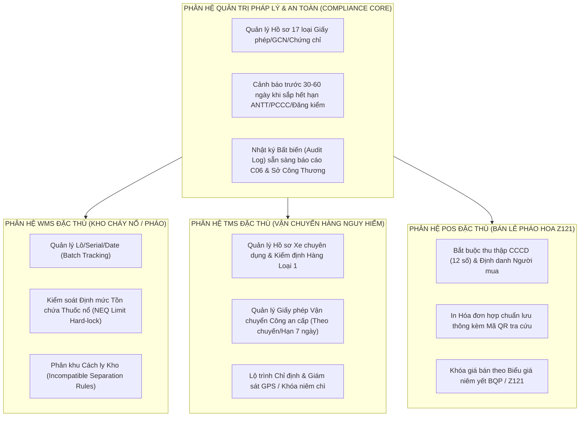

# Bàn giao Kết quả Khảo sát Chuyên sâu Nghiệp vụ Kho bãi, Kinh doanh & Vận chuyển Hàng Đặc thù (Chất cháy nổ, Vật liệu nổ, Pháo) cho BA Lead

- **Mã bàn giao:** `MKT-TO-BA-02` (Kế thừa từ yêu cầu mở rộng Cổng Brief `2026-11-14`)
- **Vai trò thực hiện:** `Marketing Lead`
- **Người nhận bàn giao:** `BA Lead` (Chịu trách nhiệm phân tích nghiệp vụ, mô hình hóa và cập nhật `BRD/SRS/REQUIREMENTS`)
- **Ngày bàn giao:** `2026-11-14`
- **Tài liệu nghiên cứu gốc:** [`2.Tai_lieu_tham_khao/5.Tai_lieu_marketing/KHAO_SAT_KHO_BAI_VAN_CHUYEN_HANG_DAC_THU_CHAY_NO_PHAO.md`](../2.Tai_lieu_tham_khao/5.Tai_lieu_marketing/KHAO_SAT_KHO_BAI_VAN_CHUYEN_HANG_DAC_THU_CHAY_NO_PHAO.md) (`REF-MKT-005`)

---

## 1. Tóm lược Kết quả Khảo sát Pháp lý & Mô hình Thực tế

Theo chỉ đạo của Chủ dự án về việc tập trung khảo sát sâu ngành hàng **sản phẩm đặc thù, chất gây cháy nổ, vật liệu nổ và pháo**, `Marketing Lead` đã hoàn thành rà soát thực tế và pháp lý tại Việt Nam:

1. **Khung pháp lý chi phối:**
   - **Luật số 42/2024/QH15** *(Luật Quản lý, sử dụng vũ khí, vật liệu nổ và CCHT - hiệu lực `01/01/2025`)*.
   - **Nghị định 137/2020/NĐ-CP** & **Nghị định 56/2023/NĐ-CP** (Quản lý, sử dụng pháo).
   - **Nghị định 34/2024/NĐ-CP** *(có hiệu lực từ `15/05/2024` thay thế NĐ 42/2020)* về Vận chuyển hàng hóa nguy hiểm Loại 1 (Chất nổ).
   - **Nghị định 96/2016/NĐ-CP** (Điều kiện An ninh, Trật tự - ANTT đối với ngành nghề đặc thù).
   - **QCVN 01:2019/BCT** (Quy chuẩn an toàn kho vật liệu nổ công nghiệp & tiền chất thuốc nổ).
   - **Nghị định 136/2020/NĐ-CP & Nghị định 50/2024/NĐ-CP** (Thẩm duyệt & nghiệm thu PCCC).
2. **Đặc thù Mô hình Kinh doanh tại Việt Nam:**
   - **Đối với Pháo hoa:** Độc quyền sản xuất và phân phối bởi doanh nghiệp Bộ Quốc phòng (**Nhà máy Z121 - Công ty TNHH MTV Hóa chất 21**). Mạng lưới bán lẻ gồm các **Cửa hàng ủy quyền Z121** được Công an tỉnh thẩm định địa điểm, cấp phép ANTT và PCCC. Khi bán lẻ cho người dân, **bắt buộc ghi nhận thông tin định danh CCCD (12 số), Họ tên, Địa chỉ** của người mua trên hóa đơn để hợp pháp hóa việc lưu thông.
   - **Đối với Vật liệu nổ công nghiệp (VLNCN):** Khách hàng 100% là B2B có Giấy phép sử dụng VLNCN (doanh nghiệp khai thác mỏ, thủy điện, công trình ngầm). Quản lý xuất bán theo định mức nổ mìn được cấp phép.
3. **Đặc thù Kho bãi (WMS):**
   - Vị trí cách ly an toàn theo bán kính sóng xung kích và mảnh văng (cách hành lang điện cao thế $\ge 30\text{ m}$).
   - Sàn kho chống phát sinh tia lửa; 100% thiết bị điện phòng nổ (Ex-proof IP54); hệ thống chống sét $R \le 10\ \Omega$ và triệt tiêu tĩnh điện.
   - Phân khu cách ly: Nghiêm cấm để chung Kíp nổ với Thuốc nổ; Tiền chất Amoni nitrat để riêng biệt.
   - Quản lý định mức tồn chứa tối đa (**NEQ/NEW — Net Explosive Quantity**) theo Giấy phép ANTT/PCCC.
   - Quản lý xuất nhập tồn nghiêm ngặt theo **Số Lô (`Batch`), Số Sê-ri (`Serial`), Ngày sản xuất, Hạn sử dụng (FIFO)**.
4. **Đặc thù Vận chuyển (TMS):**
   - Xe cơ giới chuyên dụng có kiểm định chở hàng nguy hiểm Loại 1; xích tiếp địa, bình chữa cháy, biểu trưng cảnh báo nguy hiểm Loại 1 và biển số UN màu cam.
   - Bắt buộc có **Giấy phép vận chuyển do Cục C06/C07 Bộ Công an hoặc Công an cấp tỉnh cấp** (đối với pháo hoa: cấp cho từng chuyến, thời hạn $\le 7\text{ ngày}$, phải nộp lại giấy phép sau khi vận chuyển).
   - Lộ trình chạy theo tuyến đường và khung giờ chỉ định; cấm chở khách chung phà; hạn chế qua hầm.

---

## 2. Danh mục 17 Giấy phép, Giấy Chứng nhận (GCN) & Chứng chỉ (CC) Bắt buộc cần Mô hình hóa

`BA Lead` cần đưa danh mục chứng từ tuân thủ sau vào phân hệ Quản lý Hồ sơ Pháp lý & Cảnh báo hạn (`Compliance Management`):

| Nhóm | Loại văn bản | Cơ quan cấp | Ghi chú vận hành hệ thống |
| :--- | :--- | :--- | :--- |
| **I. Doanh nghiệp & ANTT** | 1. Giấy chứng nhận ĐKDN 2. GCN đủ điều kiện về ANTT 3. Phương án bảo đảm ANTT | Sở KH&ĐT Cục C06 / Phòng PC06 Doanh nghiệp lập | Quản lý theo từng Pháp nhân và từng Chi nhánh/Địa điểm kho |
| **II. PCCC & Môi trường** | 4. GCN thẩm duyệt thiết kế PCCC 5. Văn bản nghiệm thu về PCCC 6. Giấy phép môi trường | Cục C07 / Phòng PC07 Cục C07 / Phòng PC07 Bộ TN&MT / UBND tỉnh | Quản lý theo từng Nhà kho và Điểm bán |
| **III. Chuyên ngành VLN & Pháo** | 7. Giấy phép SX/KD Pháo hoa 8. Chấp thuận địa điểm Cửa hàng bán pháo hoa 9. Giấy phép SX/KD/Sử dụng VLNCN 10. GCN đủ điều kiện bảo quản VLNCN | Bộ Quốc phòng Công an tỉnh & Z121 duyệt Bộ Công Thương / Sở CT Sở Công Thương cấp | Kiểm soát điều kiện hoạt động của Chi nhánh và Nhà kho |
| **IV. Vận chuyển hàng nguy hiểm** | 11. Giấy phép vận chuyển Pháo hoa (từng chuyến) 12. Giấy phép vận chuyển Hàng nguy hiểm Loại 1 13. Kiểm định xe chở hàng nguy hiểm Loại 1 | Cục C06 Bộ Công an Cục C07 / PC07 Công an tỉnh Cục Đăng kiểm & Cảnh sát PCCC | Gắn liền với từng Chuyến xe / Phiếu điều chuyển `TMS` |
| **V. Con người & Chứng chỉ** | 14. Chứng nhận huấn luyện nghiệp vụ PCCC 15. GCN huấn luyện an toàn VLNCN/tiền chất 16. GCN tập huấn vận chuyển hàng nguy hiểm 17. Chứng chỉ thợ mìn / chỉ huy nổ mìn | Công an PCCC cấp Sở Công Thương cấp Đơn vị được ủy quyền cấp Trường chuyên ngành cấp | Gắn với hồ sơ Nhân sự (Thủ kho, Lái xe, Áp tải) |

---

## 3. Đề xuất Kiến trúc Phân hệ cho BA Lead khi Lên Mô hình

`Marketing Lead` khuyến nghị `BA Lead` bổ sung 4 module chức năng chuyên biệt vào mô hình `WMS - TMS - POS` của dự án `QLCH`:

---

## 4. Hành động Tiếp theo của BA Lead

1. Nghiên cứu tài liệu chi tiết tại [`2.Tai_lieu_tham_khao/5.Tai_lieu_marketing/KHAO_SAT_KHO_BAI_VAN_CHUYEN_HANG_DAC_THU_CHAY_NO_PHAO.md`](../2.Tai_lieu_tham_khao/5.Tai_lieu_marketing/KHAO_SAT_KHO_BAI_VAN_CHUYEN_HANG_DAC_THU_CHAY_NO_PHAO.md).
2. Tích hợp các ràng buộc pháp lý, thực thể dữ liệu đặc thù (`NEQ`, `Mã UN`, `Số Giấy phép vận chuyển`, `Số CCCD người mua`) vào `02-nghiep-vu/REQUIREMENTS.md` và `GLOSSARY.md`.
3. Lên mô hình Use Case và luồng nghiệp vụ khép kín cho phân hệ Kho bãi (`WMS`) P1 và Vận chuyển/Bán lẻ P2 đáp ứng trọn vẹn tiêu chuẩn an toàn quốc gia.
