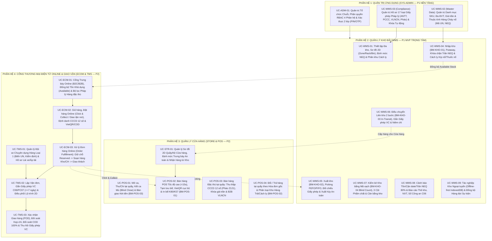

# Đặc tả Kịch bản Ca sử dụng (Use Cases) theo 04 Phân hệ — QLCH

- **Mã dự án:** `QLCH` — Hệ thống Quản lý Chuỗi Cửa hàng, Kho bãi & Thương mại Điện tử Hợp nhất (`04 Phân hệ Tách biệt: Quản trị ứng dụng - Quản lý kho bãi - Quản lý cửa hàng - Cổng TMĐT Online`)
- **Phiên bản:** `1.2` (Tích hợp đầy đủ Quyết định [`QLCH-D002`, `QLCH-D003`](file:///Users/uni/Documents/AI/AI-Workspace/AI-Workspace/TEAM_ORCA/4.Du_an/QLCH/01-quan-ly/DECISIONS.md) tách biệt 4 phân hệ và trọn bộ khảo sát từ `Marketing Lead` [`QLCH-MKT-01` & `MKT-TO-BA-02`])
- **Ngày cập nhật:** `2026-11-14`
- **Người thực hiện:** `BA Lead` (Kỹ năng `business-analysis/SKILL.md`)
- **Căn cứ truy vết chuẩn:**
  1. **Quyết định phạm vi, lộ trình & kiến trúc 4 phân hệ [`01-quan-ly/DECISIONS.md`](file:///Users/uni/Documents/AI/AI-Workspace/AI-Workspace/TEAM_ORCA/4.Du_an/QLCH/01-quan-ly/DECISIONS.md) (`QLCH-D002`, `QLCH-D003`):**
     - **Phân hệ 1 — Quản trị ứng dụng (`SYS-ADMIN` — `P1` nền tảng):** Tổ chức chuỗi, Phân quyền `RBAC` 4 phân hệ + Xác thực 2 lớp `PIN/OTP`, Danh mục dùng chung (`Master Data: SKU, Đa ĐVT, Giá trần`), Hồ sơ 17 loại Giấy phép Pháp lý & Nhật ký Kiểm toán.
     - **Phân hệ 2 — Quản lý kho bãi (`WMS` — Trọng tâm `P1 MVP`):** Kho tổng/Kho chuyên dụng/Kho cách ly, Sơ đồ 2D (`Zone/Rack/Bin`), Khóa chặn trần `NEQ` & cách ly hàng kỵ nhau, Nhập/Xuất/Điều chuyển 2 bước `In-Transit`/Kiểm kê mù, Thẻ kho bất biến & `Offline-first`.
     - **Phân hệ 3 — Quản lý cửa hàng (`STORE & POS` — `P2`):** Sơ đồ 2D quầy/kệ cửa hàng, nhận hàng điều chuyển từ kho, Mở/Kết ca mù, Bán hàng tại quầy `POS < 15s`, Bán hàng đặc thù (`CCCD 12 số` Pháo hoa `Z121`) & Đổi/Trả hàng.
     - **Phân hệ 4 — Cổng thương mại điện tử online (`ECOM` & Giao vận `TMS` — `P2`):** Cổng trưng bày & đặt hàng Online (`Storefront B2C` & `Portal B2B`) đồng bộ tồn khả dụng (`Available`), bộ lọc pháp lý hàng đặc thù, thanh toán `VietQR cục bộ / COD`, xử lý đơn hàng Online (`Order Fulfillment`) & điều phối đội xe vận chuyển (`TMS`).
  2. **Danh mục yêu cầu nghiệp vụ [`02-nghiep-vu/REQUIREMENTS.md`](file:///Users/uni/Documents/AI/AI-Workspace/AI-Workspace/TEAM_ORCA/4.Du_an/QLCH/02-nghiep-vu/REQUIREMENTS.md)** (`BR-QLCH-01..02`, `FR-ADM-01..03`, `FR-WMS-01..08`, `FR-STR-01`, `FR-POS-01..02`, `FR-ECM-01..03`, `NFR-QLCH-01..03`).
  3. **Trọn bộ tài liệu khảo sát & bàn giao từ `Marketing Lead` (`#3 QLCH-MKT-01` & `MKT-TO-BA-02`):** `REF-BIZ-003`, `REF-MKT-004` (`BM-KHO-01..04`, `BM-POS-01..03`), `REF-MKT-005` (`QCVN 01:2019/BCT`, Nghị định `137/2020/NĐ-CP`, Luật `42/2024/QH15`, Nghị định `34/2024/NĐ-CP`).

---

## 1. Danh mục Tác nhân (Actors) & Sơ đồ Kiến trúc Use Cases theo 04 Phân hệ (`QLCH-D003`)

### 1.1. Danh mục Tác nhân (Actors) trên 04 Phân hệ

| Mã Actor | Tên vai trò (Actor) | Phân hệ truy cập chính | Trách nhiệm cốt lõi trên hệ thống `QLCH` |
| :---: | :--- | :---: | :--- |
| **`ACT-OWN`** | **Chủ hệ thống / Quản trị viên (`System Owner / Admin`)** | **1. Quản trị ứng dụng (`SYS-ADMIN`)** | Cấu hình tổ chức chuỗi, phân quyền `RBAC` 4 phân hệ, quản lý Master Data (`SKU`, giá trần), quản lý 17 loại Giấy phép pháp lý (`ANTT/PCCC/VLNCN/Pháo`), phê duyệt 2 lớp (`PIN/OTP`), xem báo cáo toàn chuỗi. |
| **`ACT-WM`** | **Quản lý kho / Thủ kho (`Warehouse Manager`)** | **2. Quản lý kho bãi (`WMS`)** | Thiết lập sơ đồ kho 2D (`Zone/Rack/Bin`), cấu hình định mức `NEQ` & quy tắc phân khu cách ly (`QCVN 01:2019/BCT`), duyệt phiếu nhập/xuất/điều chuyển/kiểm kê. |
| **`ACT-WS`** | **Nhân viên kho (`Warehouse Staff`)** | **2. Quản lý kho bãi (`WMS`)** | Tác nghiệp bằng máy quét mã vạch/Mobile Web tại kệ kho: Nhận hàng, Cất hàng (`Putaway`), Soạn hàng (`Picking` đơn B2B/điều chuyển/đơn Online `ECOM`), Quét đếm kiểm kê mù (kể cả khi `Offline`). |
| **`ACT-POS`** | **Cửa hàng trưởng / Thu ngân (`Store Mgr / POS Cashier`)** | **3. Quản lý cửa hàng (`STORE & POS`)** | Quản lý sơ đồ 2D quầy/kệ cửa hàng, nhận hàng từ kho, Mở/kết ca mù (`BM-POS-03`), bán hàng `POS < 15s` (`BM-POS-01`), định danh `CCCD 12 số` khi bán Pháo hoa `Z121`, bàn giao đơn `Click & Collect` & đổi trả (`BM-POS-02`). |
| **`ACT-CUS`** | **Khách mua hàng Online (`B2C Customer / B2B Buyer`)** | **4. Cổng TMĐT Online (`ECOM`)** | Tra cứu sản phẩm & tồn khả dụng theo chi nhánh, đặt hàng trực tuyến (`Giao tận nơi` hoặc `Nhận tại cửa hàng - Click & Collect`), khai báo định danh `CCCD 12 số` (nếu mua Pháo hoa `Z121`) hoặc gắn Giấy phép `VLNCN` (`B2B`), thanh toán `VietQR cục bộ / COD`. |
| **`ACT-TMS`** | **Điều phối vận chuyển, Lái xe & Người áp tải (`Dispatcher, Driver & Escort`)** | **2. Kho bãi (`WMS`) & 4. TMĐT/Giao vận (`ECOM-TMS`)** | Điều phối xe chuyên dụng Hàng nguy hiểm Loại 1, gắn Giấy phép vận chuyển Công an cấp (`hạn <= 7 ngày`), niêm phong kẹp chì, giao hàng liên kho/giao đơn Online (`POD`), đối soát `COD` & nộp trả giấy phép. |
| **`ACT-ACC`** | **Kế toán & Pháp chế (`Accountant & Compliance`)** | **1. Quản trị (`SYS-ADMIN`) & 2. Kho bãi (`WMS`)** | Kiểm soát giá vốn bình quân (`MAC`), đối soát `NXT`, Thẻ kho, công nợ NCC, đối soát ca POS/tiền `COD` Online và trích xuất sổ báo cáo định kỳ nộp Cục `C06`, `C07`, Sở Công Thương. |

### 1.2. Sơ đồ Kiến trúc 21 Use Cases tách biệt theo 04 Phân hệ (`QLCH-D003`)

---

## 2. Bảng Ma trận Tổng hợp 21 Use Cases theo 04 Phân hệ (`QLCH-D003`)

| Mã UC | Tên Use Case | Phân hệ (`QLCH-D003`) | Giai đoạn | Ưu tiên | Truy vết Yêu cầu (`REQUIREMENTS.md`) | Truy vết Tài liệu & Biểu mẫu (`QLCH-MKT-01` & `MKT-TO-BA-02`) |
| :---: | :--- | :---: | :---: | :---: | :--- | :--- |
| **`UC-ADM-01`** | Quản trị Tổ chức Chuỗi, Phân quyền `RBAC` 4 Phân hệ, Xác thực 2 lớp (`PIN/OTP`) & Nhật ký Audit | **1. Quản trị ứng dụng (`SYS-ADMIN`)** | **`P1 MVP`** | `P0 - Bắt buộc` | `BR-QLCH-01..02`, `FR-ADM-01` | `REF-BIZ-003` (Phân quyền đa chi nhánh) & `REF-MKT-005` (Mục 7.6 — Xác thực PIN/OTP 2 lớp) |
| **`UC-WMS-02`** | Quản trị Danh mục Dùng chung (`Master Data: SKU`), Đa ĐVT (`Multi-UoM`), Lô/Serial/HSD, Giá trần & Thuộc tính Hàng Cháy nổ (`Mã UN`, `NEQ`) | **1. Quản trị ứng dụng (`SYS-ADMIN`)** *(Đồng bộ sang `WMS/POS/ECOM`)* | **`P1 MVP`** | `P0 - Bắt buộc` | `FR-ADM-02`, `FR-WMS-08`, `NFR-QLCH-01` | `REF-BIZ-003` (Mục 1) & `REF-MKT-005` (Mục 2 & 7.1 — Phân loại `VLNCN`, `Pháo hoa Z121`, `Mã UN`, `NEQ`) |
| **`UC-WMS-03`** | Quản trị Hồ sơ 17 loại Giấy phép / GCN / Chứng chỉ (`ANTT`, `PCCC`, `VLNCN`, `Pháo`) & Cảnh báo Hết hạn (`30-60 ngày`) | **1. Quản trị ứng dụng (`SYS-ADMIN`)** | **`P1 MVP`** | `P0 - Bắt buộc` | `FR-ADM-03` | `REF-MKT-005` (Mục 3 — Ma trận 17 loại Giấy phép theo NĐ `96/2016`, NĐ `136/2020`, NĐ `137/2020`, Luật `42/2024`) |
| **`UC-WMS-01`** | Thiết lập Đa kho (`Hub/Chi nhánh/Cách ly`), Sơ đồ kho 2D (`Zone/Rack/Bin`), Định mức `NEQ` & Quy tắc Phân khu Cách ly | **2. Quản lý kho bãi (`WMS`)** | **`P1 MVP`** | `P0 - Bắt buộc` | `BR-QLCH-01`, `FR-WMS-01`, `FR-WMS-02`, `FR-WMS-08` | `REF-BIZ-003` (Mục 2) & `REF-MKT-005` (`QCVN 01:2019/BCT` — Khoảng cách an toàn, Định mức `NEQ`, Phân khu cách ly) |
| **`UC-WMS-04`** | Nhập kho (`Inbound`), Cất hàng (`Putaway`), Khóa chặn Trần `NEQ` (`Hard Lock`) & Chặn Xếp chung Hàng Kỵ nhau | **2. Quản lý kho bãi (`WMS`)** | **`P1 MVP`** | `P0 - Bắt buộc` | `FR-WMS-04`, `FR-WMS-08` | **`BM-KHO-01`** (`Mẫu số 01-VT` — TT133/TT200) & `REF-MKT-005` (Mục 5.2 & 7.2) |
| **`UC-WMS-05`** | Xuất kho (`Outbound`), Soạn hàng `FEFO/FIFO` (`Picking`), Kiểm tra Giấy phép & Xuất hủy Hàng hỏng/Hết hạn | **2. Quản lý kho bãi (`WMS`)** | **`P1 MVP`** | `P0 - Bắt buộc` | `FR-WMS-04`, `FR-WMS-08` | **`BM-KHO-02`** (`Mẫu số 02-VT` — TT133/TT200) & `REF-MKT-005` |
| **`UC-WMS-06`** | Điều chuyển Liên kho 2 bước (`In-Transit Stock Transfer`), Gắn Giấy phép Vận chuyển & Niêm phong Kẹp chì | **2. Quản lý kho bãi (`WMS`)** | **`P1 MVP`** | `P0 - Bắt buộc` | `FR-WMS-05`, `FR-WMS-08` | **`BM-KHO-03`** (Phiếu Điều chuyển 2 bước) & `REF-MKT-005` (Mục 6.2) |
| **`UC-WMS-07`** | Kiểm kê Kho bằng Quét mã vạch (`Blind Count / Tally`), 3 Cột Phẩm chất & Phê duyệt Cân bằng kho 2 lớp | **2. Quản lý kho bãi (`WMS`)** | **`P1 MVP`** | `P0 - Bắt buộc` | `FR-WMS-06`, `NFR-QLCH-01` | **`BM-KHO-04`** (`Mẫu số 05-VT` — Biên bản Kiểm kê TT133/TT200) |
| **`UC-WMS-08`** | Cảnh báo Tồn tối thiểu / Cận hạn / Trần `NEQ 80%` & Báo cáo Thẻ kho, `NXT`, Sổ Báo cáo Công an (`C06`) / Sở Công Thương | **2. Quản lý kho bãi (`WMS`)** | **`P1 MVP`** | `Cao` | `FR-WMS-06`, `FR-WMS-07`, `FR-ADM-03` | `REF-BIZ-003` & `REF-MKT-005` (Mục 5.2 & 7.6) |
| **`UC-WMS-09`** | Tác nghiệp Kho Ngoại tuyến (`Offline-first WMS`) tại Kho Cách ly / Chống nổ & Đồng bộ Hàng đợi Sự kiện | **2. Quản lý kho bãi (`WMS`)** | **`P1 MVP`** | `Cao` | `NFR-QLCH-02`, `NFR-QLCH-03` | `REF-BIZ-003` (Mục 5 — `IndexedDB` + `Sync Queue`) & `REF-MKT-005` |
| **`UC-STR-01`** | Quản lý Vận hành Điểm bán, Sơ đồ 2D Quầy/Kệ Cửa hàng, Giới hạn Trưng bày An toàn & Nhận hàng Bổ sung từ Kho | **3. Quản lý cửa hàng (`STORE & POS`)** | `P2` | `Cao (P2)` | `FR-STR-01`, `FR-WMS-05` | `REF-BIZ-003` & `REF-MKT-005` (Quy định trưng bày an toàn tại điểm bán Pháo hoa `Z121`) |
| **`UC-POS-01`** | Mở ca, Thu/Chi tại quầy, Kết ca Mù (`Blind Close`) & Bàn giao Két tiền Thu ngân | **3. Quản lý cửa hàng (`STORE & POS`)** | `P2` | `Cao (P2)` | `BR-QLCH-02`, `FR-POS-01` | **`BM-POS-03`** (Biên bản Bàn giao Ca & Đối soát Két tiền) |
| **`UC-POS-02`** | Bán hàng POS Tốc độ cao (`< 15s`), Tạm lưu đa đơn (`Hold Bill`), VietQR cục bộ & In bill `K80/K57` | **3. Quản lý cửa hàng (`STORE & POS`)** | `P2` | `Cao (P2)` | `FR-POS-01`, `NFR-QLCH-01..03` | **`BM-POS-01`** (Hóa đơn POS `K80/K57`, VietQR động, chuẩn NĐ `70/2025/NĐ-CP`) |
| **`UC-POS-03`** | Bán hàng Đặc thù tại quầy: Bắt buộc Định danh `CCCD 12 số` & Khóa giá trần (Pháo hoa `Z121`) / Kiểm định mức (`VLNCN`) | **3. Quản lý cửa hàng (`STORE & POS`)** | `P2` | `Cao (P2)` | `FR-POS-02` | `REF-MKT-005` (Mục 4.1, 4.2 & 7.5 — NĐ `137/2020/NĐ-CP` & Luật `42/2024/QH15`) |
| **`UC-POS-04`** | Đổi / Trả hàng tại quầy POS theo Hóa đơn gốc & Phân loại Kho Hàng Trả / Kho Cách ly An toàn | **3. Quản lý cửa hàng (`STORE & POS`)** | `P2` | `Cao (P2)` | `FR-POS-01`, `FR-POS-02` | **`BM-POS-02`** (Phiếu Đổi / Trả Hàng) & `QCVN 01:2019/BCT` |
| **`UC-ECM-01`** | Cổng Trưng bày Trực tuyến (`Storefront B2C & Portal B2B`), Đồng bộ Tồn khả dụng (`Available`) & Bộ lọc Pháp lý Hàng đặc thù | **4. Cổng TMĐT Online (`ECOM`)** | `P2` | `Cao (P2)` | `FR-ECM-01` | `QLCH-D003` & `REF-MKT-005` (Ẩn hàng cấm dân sự `VLNCN` trên B2C, chỉ hiển thị cho B2B có giấy phép) |
| **`UC-ECM-02`** | Giỏ hàng, Đặt hàng Online (`Click & Collect / Giao tận nơi`), Định danh `CCCD 12 số` mua Pháo `Z121` & Thanh toán `VietQR cục bộ / COD` | **4. Cổng TMĐT Online (`ECOM`)** | `P2` | `Cao (P2)` | `FR-ECM-02`, `NFR-QLCH-03` | `QLCH-D003`, **`BM-POS-01`** & Nghị định `137/2020/NĐ-CP` (Khóa giá trần & định danh người mua) |
| **`UC-ECM-03`** | Xử lý Đơn hàng Online (`Omnichannel Order Fulfillment`): Giữ chỗ `Reserved` $\rightarrow$ Soạn hàng tại `WMS`/`Cửa hàng` $\rightarrow$ Bàn giao Giao vận | **4. Cổng TMĐT Online (`ECOM`)** | `P2` | `Cao (P2)` | `FR-ECM-03` | `QLCH-D003` & `REF-BIZ-003` (Đồng bộ tồn kho Đa kênh chống bán vượt tồn `Overselling`) |
| **`UC-TMS-01`** | Quản lý Đội xe Chuyên dụng Hàng Nguy hiểm Loại 1 (`Biển UN`, Kiểm định, PCCC) & Chứng chỉ Lái xe / Người áp tải | **4. Cổng TMĐT Online & Giao vận (`ECOM-TMS`)** | `P2` | `Cao (P2)` | `FR-ECM-03` | `REF-MKT-005` (Mục 6.1 — Nghị định `34/2024/NĐ-CP`) |
| **`UC-TMS-02`** | Lập Vận đơn, Gắn Giấy phép Vận chuyển (`C06/PC07`, hạn `<= 7 ngày`), Kiểm tra Ghép hàng & Điều phối Lộ trình 2D | **4. Cổng TMĐT Online & Giao vận (`ECOM-TMS`)** | `P2` | `Cao (P2)` | `FR-ECM-03` | `REF-MKT-005` (Mục 6.2 & 7.4 — Giấy phép vận chuyển từng chuyến) |
| **`UC-TMS-03`** | Xác nhận Giao hàng (`POD`), Kiểm tra Niêm phong Kẹp chì, Đối soát `COD` 100% & Theo dõi Nộp trả Giấy phép Vận chuyển | **4. Cổng TMĐT Online & Giao vận (`ECOM-TMS`)** | `P2` | `Cao (P2)` | `FR-ECM-03` | `REF-MKT-005` (Mục 6.2 — Hoàn trả Giấy phép vận chuyển trong vòng `07 ngày`) |

---

## 3. Đặc tả Chi tiết 09 Use Cases Trọng tâm Giai đoạn 1 (`P1 MVP — Hệ thống Kho bãi WMS & Tuân thủ Hàng Đặc thù`)

### `UC-WMS-01`: Thiết lập Đa kho (`Hub/Chi nhánh`), Sơ đồ kho 2D (`Zone/Rack/Bin`), Định mức `NEQ` & Quy tắc Phân khu Cách ly
- **Tác nhân chính:** `Chủ chuỗi (ACT-OWN)`, `Quản lý kho (ACT-WM)`.
- **Truy vết:** `BR-QLCH-01`, `FR-WMS-01`, `FR-WMS-02`, `FR-WMS-08`; `REF-BIZ-003` (Mục 2) & `REF-MKT-005` (Mục 5.1 — `QCVN 01:2019/BCT`).
- **Luồng chính (Happy Path):**
  1. Người dùng khởi tạo hoặc cấu hình Kho trong hệ thống (`Kho tổng Hub/DC`, `Kho chi nhánh / Cửa hàng Z121`, `Kho chuyên dụng VLNCN/Hóa chất`), kèm các kho con logic (`Kho Hàng Tốt - Sellable` và `Kho Hàng Lỗi / Cách ly chờ hủy - Quarantine`).
  2. Thiết lập cấu trúc phân cấp vị trí lưu trữ: `Khu vực / Buồng kho (Zone)` $\rightarrow$ `Dãy/Kệ/Pallet (Rack)` $\rightarrow$ `Tầng/Ô chứa (Bin)` và gắn thuộc tính an toàn đặc thù cho từng Kho / `Zone`:
     - **Định mức tồn chứa thuốc nổ/thuốc pháo quy đổi tối đa (`Max NEQ / NEW Limit`**, tính bằng `kg` hoặc `tấn` theo Giấy chứng nhận ANTT/PCCC được cấp).
     - **Nhóm tương thích lưu trữ (`Compatibility Group` theo `QCVN 01:2019/BCT`):** Ví dụ `Zone A: Chỉ chứa Thuốc nổ`, `Zone B (Buồng cách ly chống nổ): Chỉ chứa Kíp nổ / Phụ kiện nổ`, `Zone C: Tiền chất Amoni Nitrat ($NH_4NO_3$ — cách ly hoàn toàn dầu mỡ/axít/kim loại kiềm)`, `Zone D: Pháo hoa tiêu dùng Z121`, `Zone E: Hàng tiêu dùng thông thường`.
     - **Chỉ số kỹ thuật an toàn kho:** Điện trở nối đất chống sét ($R \le 10\ \Omega$), chuẩn thiết bị điện phòng nổ (`Ex-proof IP54`), ngưỡng nhiệt độ & độ ẩm bảo quản tối đa.
  3. Trên màn hình **Thiết kế Sơ đồ kho 2D (`2D Warehouse Layout Builder`)**, người dùng bố trí trực quan các khối `Zone/Rack/Bin`, vành đai an toàn ngoại vi, tường chắn nổ, vị trí bình chữa cháy và tủ điện ngoài kho.
  4. Hệ thống sinh mã định danh vị trí (`Bin Barcode/QR`) và in hàng loạt tem vị trí qua máy in nhiệt.
  5. Khi vận hành, **Sơ đồ kho 2D** hiển thị trực quan thanh phần trăm tải trọng **`% NEQ hiện tại / Max NEQ`** của từng buồng kho cùng màu sắc cảnh báo (Xanh: $< 80\%$ `NEQ`, Vàng: $80\% - 95\%$ `NEQ` hoặc có lô cận date, Đỏ: chạm trần `NEQ` hoặc vi phạm nhiệt độ/độ ẩm).
- **Luồng ngoại lệ (Exceptions):**
  - *`E1 - Kho hàng đặc thù chưa có Giấy phép ANTT & Nghiệm thu PCCC còn hiệu lực`:* Hệ thống khóa trạng thái kích hoạt nhận hàng (`Locked for Inbound` đối với nhóm hàng cháy nổ/pháo) cho đến khi gắn hồ sơ giấy phép hợp lệ tại `UC-WMS-03`.

---

### `UC-WMS-02`: Quản lý Danh mục Hàng hóa (`SKU`), Đa ĐVT (`Multi-UoM`), Lô/Serial/HSD & Thuộc tính Hàng Cháy nổ (`Mã UN`, `NEQ`)
- **Tác nhân chính:** `Quản lý kho (ACT-WM)`.
- **Truy vết:** `FR-WMS-03`, `FR-WMS-08`, `NFR-QLCH-01`; `REF-BIZ-003` (Mục 1) & `REF-MKT-005` (Mục 2 & 7.1).
- **Luồng chính (Happy Path):**
  1. Quản lý kho tạo hoặc cập nhật `SKU` với thông tin cơ bản: Mã `SKU`, Mã vạch (`Barcode/QR`), Tên hàng, Thương hiệu/Nhà máy sản xuất (ví dụ: `Nhà máy Z121`, `MICCO`...), Đơn vị tính cơ sở (`Base UoM` — ví dụ: `Giàn`, `Hộp`, `Kg`, `Kíp`) và bảng **Quy đổi Đa đơn vị tính (`Multi-UoM`**, ví dụ: `1 Thùng = 20 Giàn`).
  2. Chọn **Phân loại Quản lý Hàng hóa (`Product Regulatory Type`)**:
     - `Loại 0 — Hàng tiêu dùng / Bán lẻ thông thường`
     - `Loại 1A — Vật liệu nổ công nghiệp (Thuốc nổ / Phụ kiện kíp nổ, dây nổ)`
     - `Loại 1B — Tiền chất thuốc nổ (Amoni Nitrat >= 98.5%, Natri Nitrat...)`
     - `Loại 2 — Pháo hoa tiêu dùng (Z121 — Không gây tiếng nổ, được phép bán lẻ dân sự)`
     - `Loại 3 — Chất dễ cháy nổ / Hóa chất nguy hiểm (LPG, Khí công nghiệp, Dung môi Loại 2, 3, 4)`
  3. Nếu thuộc nhóm Hàng đặc thù (`Loại 1A, 1B, 2, 3`), hệ thống bắt buộc nhập bộ **Thuộc tính An toàn & Pháp lý (`Hazardous Metadata`)**:
     - **Mã số Liên Hợp Quốc (`UN Number`**, ví dụ: `UN 0336` cho Pháo hoa 1.4G, `UN 1942` cho Amoni Nitrat) và **Nhóm nguy hiểm (`Hazard Division`: `1.1`, `1.3`, `1.4G`...)**.
     - **Định lượng thuốc nổ/thuốc pháo quy đổi trên 1 đơn vị cơ sở (`Unit NEQ / NEW` tính bằng `kg`)** để hệ thống tự động nhân với số lượng tồn kho khi kiểm soát trần kho.
     - **Nhóm kỵ lưu trữ (`Incompatibility Group`)**: Đánh dấu rõ `Thuốc nổ` vs `Kíp nổ` vs `Dầu mỡ/Axít`.
     - **Bắt buộc quản lý theo `Số Lô (Batch/Lot)`, `Số Sê-ri thùng/hộp (Serial)`, `Ngày sản xuất` & `Hạn sử dụng (`FIFO/FEFO`)`**.
     - **Giá bán lẻ niêm yết trần (`Regulated Ceiling Price`**, áp dụng cho Pháo hoa `Z121`).
  4. In tem nhãn mã vạch/QR chứa đủ tổ hợp: `Mã SKU + Số Lô + Số Thùng/Serial + Ngày SX/HSD + Cảnh báo Nhóm Nguy hiểm`.
- **Luồng ngoại lệ (Exceptions):**
  - *`E1 - Khai báo sản phẩm thuộc danh mục Nghiêm cấm dân sự (Pháo nổ / Pháo hoa nổ trái phép)`:* Hệ thống hiển thị cảnh báo pháp lý theo Nghị định `137/2020/NĐ-CP` và chặn lưu nếu không có giấy phép đặc biệt của Thủ tướng Chính phủ / Bộ Quốc phòng.

---

### `UC-WMS-03`: Quản lý Hồ sơ 17 loại Giấy phép / GCN / Chứng chỉ (`ANTT`, `PCCC`, `VLNCN`, `Pháo`) & Cảnh báo Hết hạn (`30-60 ngày`)
- **Tác nhân chính:** `Chủ chuỗi (ACT-OWN)`, `Quản lý kho (ACT-WM)`, `Kế toán & Pháp chế (ACT-ACC)`.
- **Truy vết:** `FR-WMS-09`; `REF-MKT-005` (Mục 3 — Ma trận 17 loại Giấy phép bắt buộc).
- **Luồng chính (Happy Path):**
  1. Người dùng truy cập phân hệ **Hồ sơ Pháp lý & Tuân thủ An toàn (`Compliance & License Registry`)**, cập nhật và đính kèm bản chụp/PDF cục bộ cho 5 nhóm hồ sơ (17 loại chứng từ):
     - **Nhóm I (Doanh nghiệp & ANTT):** (1) GCN Đăng ký doanh nghiệp, (2) **GCN đủ điều kiện về ANTT (`C06/PC06`)**, (3) Phương án bảo đảm ANTT.
     - **Nhóm II (PCCC & Môi trường):** (4) GCN thẩm duyệt thiết kế PCCC, (5) **Văn bản chấp thuận nghiệm thu PCCC (`C07/PC07`)**, (6) Giấy phép môi trường.
     - **Nhóm III (Chuyên ngành VLN & Pháo):** (7) Giấy phép SX/KD Pháo hoa (`BQP`), (8) Văn bản chấp thuận địa điểm Cửa hàng pháo hoa (`Công an tỉnh & Z121`), (9) Giấy phép SX/KD/Sử dụng `VLNCN` (`Bộ/Sở Công Thương`), (10) **GCN đủ điều kiện bảo quản `VLNCN`/Tiền chất (`Sở Công Thương`)**.
     - **Nhóm IV (Vận chuyển Hàng nguy hiểm):** (11) **Giấy phép vận chuyển Pháo hoa từng chuyến (`C06`, hạn $\le 7$ ngày)**, (12) **Giấy phép vận chuyển Hàng nguy hiểm Loại 1 (`C07/PC07`)**, (13) GCN kiểm định ATKT & BVMT xe chở hàng nguy hiểm.
     - **Nhóm V (Chứng chỉ Con người):** (14) CN huấn luyện nghiệp vụ PCCC & CNCH (`5 năm`), (15) GCN huấn luyện kỹ thuật an toàn `VLNCN`/tiền chất (`2 năm`), (16) GCN tập huấn an toàn vận chuyển hàng nguy hiểm (`2 năm`), (17) Chứng chỉ thợ nổ mìn / chỉ huy nổ mìn.
  2. Mỗi giấy phép được gắn trực tiếp với thực thể tương ứng (`Kho`, `Cửa hàng`, `Phương tiện xe`, `Nhân sự Thủ kho/Lái xe/Người áp tải`) kèm `Số giấy phép`, `Cơ quan cấp`, `Ngày cấp`, `Ngày hết hạn` và `Định mức NEQ cấp phép (nếu có)`.
  3. Hệ thống tự động quét hàng ngày và hiển thị cảnh báo trước **$60\text{ ngày}$ (Vàng)** và **$30\text{ ngày}$ (Đỏ)** trước khi giấy phép hết hạn.
- **Luồng ngoại lệ (Exceptions):**
  - *`E1 - Giấy phép của Kho, Xe hoặc Chứng chỉ Nhân sự đã hết hạn (Expired)`:* Hệ thống tự động **khóa quyền thực thi (`Hard Compliance Lock`)**: không cho phép chọn Kho hết hạn PCCC/ANTT để nhập thêm hàng cháy nổ, không cho phép gán Xe hết hạn đăng kiểm hoặc Lái xe/Thủ kho hết hạn chứng chỉ PCCC vào lệnh điều chuyển/xuất kho.

---

### `UC-WMS-04`: Nhập kho (`Inbound`), Cất hàng (`Putaway`), Khóa chặn Trần `NEQ` (`Hard Lock`) & Chặn Xếp chung Hàng Kỵ nhau (`BM-KHO-01`)
- **Tác nhân chính:** `Quản lý kho (ACT-WM)`, `Nhân viên kho (ACT-WS)`, `Kế toán kho (ACT-ACC)`.
- **Truy vết:** `FR-WMS-04`, `FR-WMS-08`; Biểu mẫu **`BM-KHO-01` (`Mẫu số 01-VT` — TT133/TT200)** & `REF-MKT-005` (Mục 5.2, 7.2).
- **Luồng chính (Happy Path):**
  1. **Lập Phiếu Nhập kho (`BM-KHO-01`):** Ghi nhận Kho nhập, Nhà cung cấp (hoặc Nhà máy `Z121`/`MICCO`), Số hóa đơn gốc, Số Giấy phép vận chuyển đi kèm lô hàng nhập, danh sách `SKU`, **`Số lượng theo chứng từ`**, Đơn giá, Chiết khấu, Thuế GTGT, Chi phí nhập phân bổ.
  2. **Kiểm tra Tự động Định mức `NEQ` trước khi Nhập (`NEQ Capacity Pre-check`):**
     - Với hàng đặc thù có thuộc tính `Unit NEQ > 0`, hệ thống tự động tính:
       $$\text{Tổng NEQ dự kiến sau nhập} = \text{Tổng NEQ hiện tại trong kho} + \sum_{i=1}^{n} (\text{SL Thực nhập}_i \times \text{Unit NEQ}_i)$$
     - Cảnh báo vàng nếu đạt $\ge 80\%$ định mức cấp phép của Kho/`Zone`.
  3. **Kiểm nhận bằng Mã vạch & Phân bổ Vị trí (`Receiving & Safe Putaway`):**
     - Nhân viên kho quét mã vạch kiện hàng, xác nhận **`Số lượng thực nhập`**, `Số Lô (Batch)`, `Số Serial thùng`, `Ngày SX` & `Hạn sử dụng`.
     - Hệ thống gợi ý vị trí `Rack/Bin` trên **Sơ đồ kho 2D** tuân thủ nghiêm ngặt **Quy tắc Phân khu Cách ly (`Incompatible Storage Separation`)**: chỉ gợi ý `Bin` thuộc `Zone` tương thích.
     - Nhân viên kho quét **Mã vạch `Bin`** + **Mã vạch `SKU/Lô`** để xác nhận cất hàng.
  4. **Hoàn tất & Tính Giá vốn `MAC`:**
     - Chỉ cộng tồn kho và công nợ theo đúng **`Số lượng thực nhập`** quy đổi về `Base UoM`.
     - Cập nhật `Tổng NEQ hiện tại` của Kho/`Zone` và tính lại **Giá vốn bình quân gia quyền (`MAC`)** theo công thức chuẩn `BM-KHO-01`.
     - Ghi sổ Thẻ kho bất biến và in **Phiếu Nhập Kho (`Mẫu số 01-VT`)**.
- **Luồng ngoại lệ (Exceptions):**
  - *`E1 - Vượt định mức tồn chứa thuốc nổ cấp phép (`Tổng NEQ dự kiến > Max NEQ của Kho/Zone`)`:* Hệ thống kích hoạt **`Khóa chặn cứng (Hard Validation Lock)`** — tuyệt đối không cho phép hoàn tất nhập vượt trần `NEQ` trên Giấy phép ANTT/PCCC và gợi ý điều phối sang kho khác còn hạn mức.
  - *`E2 - Vi phạm quy tắc cách ly (`Quét cất Kíp nổ vào cùng Buồng/Zone đang chứa Thuốc nổ`, hoặc `Amoni Nitrat chung với Dầu mỡ/Axít`)`:* Thiết bị cầm tay phát còi cảnh báo đỏ và **chặn tuyệt đối thao tác `Putaway`** theo `QCVN 01:2019/BCT`.

---

### `UC-WMS-05`: Xuất kho (`Outbound`), Soạn hàng `FEFO/FIFO` (`Picking`), Kiểm tra Giấy phép & Xuất hủy Hàng hỏng (`BM-KHO-02`)
- **Tác nhân chính:** `Quản lý kho (ACT-WM)`, `Nhân viên kho (ACT-WS)`.
- **Truy vết:** `FR-WMS-03`, `FR-WMS-04`, `FR-WMS-08`; Biểu mẫu **`BM-KHO-02` (`Mẫu số 02-VT`)** & `REF-MKT-005` (Mục 4.2, 5.2, 7.6).
- **Luồng chính (Happy Path):**
  1. **Lập Phiếu Xuất kho (`BM-KHO-02`):** Chọn lý do xuất (`Xuất bán B2B/Bán buôn`, `Xuất trả NCC`, `Xuất nội bộ`, hoặc `Xuất hủy hàng hỏng/ẩm ướt/hết hạn`).
  2. **Kiểm tra Điều kiện Pháp lý khi Xuất Hàng Đặc thù:**
     - Nếu xuất bán `VLNCN` / Tiền chất thuốc nổ (`B2B`): Hệ thống bắt buộc chọn Khách hàng doanh nghiệp có **`Giấy phép sử dụng VLNCN`** còn hiệu lực và kiểm tra `Số lượng xuất <= Hạn mức nổ mìn còn lại` trên giấy phép của khách hàng; đồng thời gắn **`Số Giấy phép vận chuyển Hàng nguy hiểm Loại 1`**, `Biển số xe chuyên dụng` và `Họ tên/CCCD Người nhận & Người áp tải`.
  3. **Giữ chỗ & Chỉ định Lấy hàng theo Lô (`FEFO / FIFO Picking` trên Sơ đồ 2D):**
     - Tạm khóa số lượng vào `Tồn giữ chỗ (Reserved)`.
     - Tự động chỉ định lấy đúng `Lô/Serial` theo nguyên tắc `FIFO/FEFO` và hiển thị vị trí `Rack/Bin` trên **Sơ đồ kho 2D**.
  4. **Quét mã Xác nhận Thực xuất & Xác thực 2 lớp (`PIN/OTP`):**
     - Nhân viên kho quét `Mã Bin` + `Mã Lô/Serial` lấy hàng.
     - Với phiếu xuất Hàng đặc thù hoặc phiếu **`Xuất hủy`**, hệ thống yêu cầu `Quản lý kho / Chủ chuỗi` nhập **Mã PIN/OTP xác thực 2 lớp** trước khi trừ `Tồn thực tế (On-hand)`, giảm `Tổng NEQ hiện tại`, hạch toán chi phí hủy (nếu là xuất hủy) và in **Phiếu Xuất Kho (`Mẫu số 02-VT`)**.
- **Luồng ngoại lệ (Exceptions):**
  - *`E1 - Xuất vượt Tồn khả dụng (`SL Thực xuất > Available`) hoặc vượt Hạn mức Giấy phép của khách hàng B2B`:* Hệ thống chặn hoàn tất phiếu xuất.
  - *`E2 - Quét sai Lô/Serial so với Lệnh xuất Hàng đặc thù`:* Hệ thống chặn ngay tại bước quét mã để đảm bảo 100% truy xuất nguồn gốc từng thùng pháo/bao thuốc nổ.

---

### `UC-WMS-06`: Điều chuyển Liên kho 2 bước (`In-Transit Stock Transfer`), Gắn Giấy phép Vận chuyển & Niêm phong Kẹp chì (`BM-KHO-03`)
- **Tác nhân chính:** `Quản lý kho Xuất`, `Quản lý kho Nhận`, `Nhân viên kho (ACT-WS)`.
- **Truy vết:** `FR-WMS-05`, `FR-WMS-08`; Biểu mẫu **`BM-KHO-03`** & `REF-MKT-005` (Mục 6.1, 6.2).
- **Luồng chính (Happy Path — Quy trình 2 bước):**
  1. **Lập Phiếu Điều chuyển (`PDC` — `BM-KHO-03`):** Chọn `Kho Xuất`, `Kho Nhận`, danh sách `SKU/Lô`, `SL Yêu cầu`.
     - Nếu điều chuyển **Pháo hoa hoặc Vật liệu nổ**, bắt buộc đính kèm **`Số Giấy phép vận chuyển do C06/PC07 cấp`** (kiểm tra còn hạn $\le 7\text{ ngày}$), chọn `Xe chuyên dụng Hàng Loại 1`, `Lái xe`, `Người áp tải` và nhập **`Mã số Khóa niêm phong kẹp chì (Seal No)`**.
     - Hệ thống kiểm tra trước: đảm bảo `Kho Nhận` không bị vượt trần `Max NEQ` khi nhận lô hàng này, và trên cùng 1 chuyến xe không có cả `Kíp nổ` lẫn `Thuốc nổ`.
  2. **Bước 1 — Kho Xuất xác nhận Xuất chuyển (`In-Transit`):**
     - Quét mã `Picking` theo đúng `Lô/Serial`, khóa niêm chì thùng xe và bấm `Xuất chuyển`.
     - Hệ thống **trừ tồn kho và giảm `NEQ` tại `Kho Xuất`**, chuyển toàn bộ lượng hàng sang trạng thái **`Tồn đang vận chuyển (In-Transit Inventory)`** (chưa cộng vào `Kho Nhận`). In phiếu `BM-KHO-03`.
  3. **Bước 2 — Kho Nhận kiểm tra Niêm chì & Xác nhận Thực nhận (`Completed`):**
     - Khi xe đến `Kho Nhận`, Thủ kho nhận kiểm tra đối chiếu **`Mã số Kẹp chì (Seal No)`** nguyên vẹn, quét mã vạch kiểm đếm **`SL Thực nhận`** theo từng `Lô/Serial` và thực hiện `Putaway` vào `Bin`.
     - Hệ thống giải phóng `In-Transit`, cộng tồn kho và tăng `NEQ` tương ứng tại `Kho Nhận`.
- **Luồng ngoại lệ (Exceptions):**
  - *`E1 - Rách niêm phong kẹp chì hoặc Lệch số lượng (`SL Thực nhận != SL Xuất chuyển`)`:* Hệ thống giữ phần lệch ở trạng thái `Lệch điều chuyển chờ xử lý`, phát cảnh báo khẩn cấp cho `Chủ chuỗi` (đặc biệt nghiêm trọng nếu thất thoát hàng cháy nổ/pháo trên đường vận chuyển) và yêu cầu lập biên bản xác thực 2 lớp.

---

### `UC-WMS-07`: Kiểm kê Kho bằng Quét mã vạch (`Blind Count / Tally`), 3 Cột Phẩm chất & Phê duyệt Cân bằng kho 2 lớp (`BM-KHO-04`)
- **Tác nhân chính:** `Quản lý kho (ACT-WM)`, `Nhân viên kho (ACT-WS)`, `Chủ chuỗi (ACT-OWN)`.
- **Truy vết:** `FR-WMS-06`, `NFR-QLCH-01`; Biểu mẫu **`BM-KHO-04` (`Mẫu số 05-VT`)** & `REF-MKT-005` (Mục 7.6).
- **Luồng chính (Happy Path):**
  1. **Chốt mốc Kiểm kê (`Snapshot`) & Bật Kiểm kê mù (`Blind Count`):** Hệ thống chụp số `Tồn theo Sổ/Hệ thống` theo từng `Bin` và `Lô/Serial`, ẩn số tồn hệ thống trên màn hình nhân viên đếm.
  2. **Quét mã vạch cộng dồn (`Barcode Scan Tally`) & Phân loại 3 cột Phẩm chất (`Mẫu số 05-VT`):**
     - Nhân viên quét mã `Bin` và bắn liên tiếp mã vạch sản phẩm/lô (`+1` mỗi lần quét, `< 1s`).
     - Phân loại thực đếm theo 3 trạng thái: `(1) Còn tốt 100%`, `(2) Kém phẩm chất (móp vỏ, cận date)`, `(3) Mất phẩm chất / Hư hỏng / Ẩm ướt (bắt buộc cách ly chờ tiêu hủy an toàn)`.
  3. **Duyệt Cân bằng kho bằng Xác thực 2 lớp (`PIN/OTP`):**
     - Hệ thống tính chênh lệch `Thừa (+)` / `Thiếu (-)` cả về số lượng, giá trị tiền (`MAC`) và trọng lượng `NEQ`.
     - Khi Chủ chuỗi/Quản lý kho nhập **PIN/OTP phê duyệt `Cân bằng kho`**, hệ thống tự động sinh Phiếu Nhập/Xuất điều chỉnh trong Thẻ kho, chuyển hàng hỏng/ẩm ướt sang `Kho Cách ly (Quarantine)` và xuất bản in **Biên bản Kiểm kê (`Mẫu số 05-VT`)**.

---

### `UC-WMS-08`: Cảnh báo Tồn tối thiểu / Cận hạn / Trần `NEQ 80%` & Báo cáo Thẻ kho, `NXT`, Sổ Báo cáo Công an (`C06`) / Sở Công Thương
- **Tác nhân chính:** `Chủ chuỗi (ACT-OWN)`, `Quản lý kho (ACT-WM)`, `Kế toán & Pháp chế (ACT-ACC)`.
- **Truy vết:** `FR-WMS-06`, `FR-WMS-07`, `FR-WMS-09`; `REF-MKT-005` (Mục 5.2, 7.6).
- **Luồng chính (Happy Path):**
  1. **Trung tâm Cảnh báo Kho & Pháp lý (`Alert Center & 2D Map Badges`):**
     - Cảnh báo tồn kho chạm ngưỡng `Min Stock` hoặc vượt `Max Stock`.
     - Cảnh báo lô hàng sắp hết hạn (`Near-Expiry`) hoặc đã hết hạn (`Expired`).
     - Cảnh báo an toàn kho đặc thù: Tổng lượng thuốc nổ/thuốc pháo đạt $\ge 80\%$ định mức `NEQ`; Giấy phép `ANTT/PCCC/VLNCN/Kiểm định xe/Chứng chỉ nhân sự` còn $< 30 - 60\text{ ngày}$; Giấy phép vận chuyển pháo hoa sắp quá hạn 7 ngày phải nộp trả Công an.
  2. **Báo cáo Nhập - Xuất - Tồn (`NXT`), Thẻ kho (`Stock Card`) & Sổ Theo dõi Pháp lý Bất biến:**
     - Truy xuất Báo cáo `NXT` và `Thẻ kho` chi tiết đến từng `Bin`, `Lô/Serial`, đảm bảo khớp 100% công thức lũy kế.
     - **Trích xuất Sổ theo dõi Xuất - Nhập - Tồn Hàng đặc thù (`Compliance Audit Report`)** nộp định kỳ cho **Cục `C06/PC06` Bộ Công an** và **Sở Công Thương**: hiển thị đầy đủ Ngày giờ, Số chứng từ, Tên hàng, Số Lô/Serial, Trọng lượng `NEQ`, Họ tên & Số `CCCD` người nhận/mua, Biển số xe và Số Giấy phép vận chuyển Công an cấp.

---

### `UC-WMS-09`: Tác nghiệp Kho Ngoại tuyến (`Offline-first WMS`) tại Kho Cách ly / Chống nổ & Đồng bộ Hàng đợi Sự kiện
- **Tác nhân chính:** `Nhân viên kho (ACT-WS)`, `Quản lý kho (ACT-WM)`.
- **Truy vết:** `NFR-QLCH-02`, `NFR-QLCH-03`; `REF-BIZ-003` (Mục 5) & `REF-MKT-005` (Mục 5.1).
- **Luồng chính (Happy Path):**
  1. Do đặc thù các kho `VLNCN`/pháo hoa thường đặt ở khu vực cách ly xa dân cư, có ụ đất/tường chắn nổ dày gây cản sóng Wi-Fi/4G, ứng dụng Web App tự động nạp dữ liệu phiên làm việc (`SKU`, `Barcode`, `Lô/HSD`, `Sơ đồ 2D Bin`, `Giới hạn NEQ`, `Quy tắc cách ly`) vào bộ nhớ cục bộ **`IndexedDB`**.
  2. Khi mất mạng trong kho, nhân viên vẫn quét mã vạch kiểm kê, cất hàng `Putaway` và lấy hàng `Picking` bình thường (`< 1 giây/thao tác`); toàn bộ quy tắc kiểm tra **Chặn vượt trần `NEQ`** và **Chặn xếp chung Kíp nổ + Thuốc nổ** vẫn hoạt động **100% ngay ở chế độ Offline**.
  3. Khi ra khỏi buồng kho và có kết nối mạng lại, hệ thống tự động đồng bộ tuần tự các sự kiện biến động (`Delta Events`) trong `Sync Queue` lên Server và kiểm tra xung đột an toàn.

---

## 4. Đặc tả Định khung 07 Use Cases Giai đoạn 2 (`P2 — Bán lẻ POS & Vận chuyển Hàng Đặc thù TMS`)

### `UC-POS-01`: Mở ca, Thu/Chi tại quầy, Kết ca Mù (`Blind Close`) & Bàn giao Két tiền (`BM-POS-03`)
- **Truy vết:** `FR-POS-01`; Biểu mẫu **`BM-POS-03`**.
- **Luồng cốt lõi:** Xác nhận `Tiền mặt đầu ca` $\rightarrow$ Ghi nhận tự động `Thu tiền mặt bán hàng`, `Chi hoàn tiền trả hàng`, `Phiếu thu/chi tại quầy` $\rightarrow$ Cuối ca thu ngân nhập **`Tiền mặt thực đếm cuối ca` theo mệnh giá (`Blind Close` ẩn số lý thuyết)** $\rightarrow$ Đối chiếu `Chênh lệch quỹ ca` và in biên bản bàn giao ca `BM-POS-03`.

### `UC-POS-02`: Bán hàng POS Tốc độ cao (`< 15s`), Tạm lưu đa đơn (`Hold Bill`), VietQR cục bộ & In bill `K80/K57` (`BM-POS-01`)
- **Truy vết:** `FR-POS-01`, `NFR-QLCH-01..03`; Biểu mẫu **`BM-POS-01` (Chuẩn Nghị định `70/2025/NĐ-CP`)**.
- **Luồng cốt lõi:** Quét mã vạch tính tiền tức thì, hỗ trợ phím tắt `F1–F12`, tạm lưu nhiều hóa đơn (`Hold Order`), thanh toán kết hợp Tiền mặt + **VietQR động sinh cục bộ (`$0 First`)**, in hóa đơn nhiệt `K80/K57` kèm thông tin chuẩn HĐĐT máy tính tiền và trừ tồn kho trực tiếp từ Kho cửa hàng (`WMS`).

### `UC-POS-03`: Bán hàng Đặc thù: Bắt buộc Định danh `CCCD 12 số` & Khóa giá trần (Pháo hoa `Z121`) / Kiểm định mức (`VLNCN`)
- **Truy vết:** `FR-POS-02`; `REF-MKT-005` (Mục 4.1, 4.2, 7.5 — Nghị định `137/2020/NĐ-CP` & Luật `42/2024/QH15`).
- **Luồng cốt lõi:**
  1. **Khi giỏ hàng POS có sản phẩm `Pháo hoa tiêu dùng (Z121)`:**
     - Hệ thống tự động chuyển trường Thông tin người mua từ *Tùy chọn* sang **Bắt buộc (`Mandatory`)**: Thu ngân phải nhập hoặc quét mã QR trên thẻ **Căn cước công dân (`Số CCCD 12 số`, `Họ và tên`, `Ngày sinh >= 18 tuổi`, `Địa chỉ thường trú`, `Số điện thoại`)** và chọn đúng `Số Lô / Serial giàn pháo` xuất bán.
     - **Khóa giá bán (`Price Ceiling Lock`):** Không cho phép sửa đơn giá cao hơn bảng giá niêm yết chính thức của Nhà máy `Z121` / Bộ Quốc phòng.
     - In Hóa đơn bán hàng kiêm Giấy xác nhận nguồn gốc hợp pháp có đầy đủ `Họ tên, Số CCCD, Địa chỉ người mua, Số Lô pháo` và `Mã QR tra cứu` để người dân xuất trình khi lưu thông trên đường.
  2. **Khi xuất bán `Vật liệu nổ công nghiệp (VLNCN)`:** Chặn bán lẻ tự do tại quầy cho cá nhân; chỉ cho phép lập đơn B2B khi khách hàng có `Giấy phép sử dụng VLNCN` còn hiệu lực và số lượng nằm trong định mức được duyệt.

### `UC-POS-04`: Đổi / Trả hàng tại quầy POS theo Hóa đơn gốc & Phân loại Kho Hàng Trả / Kho Cách ly (`BM-POS-02`)
- **Truy vết:** `FR-POS-01`, `FR-POS-02`; Biểu mẫu **`BM-POS-02`**.
- **Luồng cốt lõi:** Quét mã hóa đơn gốc `BM-POS-01`, lấy đúng đơn giá thực tế sau khuyến mãi lúc mua; phân loại hàng trả về `Kho Bán Hàng (Sellable)` (nếu nguyên tem mác, an toàn 100%) hoặc bắt buộc đưa vào **`Kho Cách ly An toàn (Quarantine Stock)`** (nếu vỏ hộp pháo/hóa chất bị rách, ẩm ướt, móp méo để chờ kiểm tra kỹ thuật/tiêu hủy, tuyệt đối không bán lại cho khách sau).

### `UC-TMS-01`: Quản lý Đội xe Chuyên dụng Hàng Nguy hiểm Loại 1 (`Biển UN`, Kiểm định, PCCC) & Chứng chỉ Lái xe / Người áp tải
- **Truy vết:** `FR-TMS-01`, `FR-TMS-02`; `REF-MKT-005` (Mục 6.1 — Nghị định `34/2024/NĐ-CP`).
- **Luồng cốt lõi:** Quản lý hồ sơ từng xe tải chuyên dụng (Biển số, tải trọng tối đa, hạn `GCN kiểm định ATKT chở hàng nguy hiểm Loại 1`, trang bị xích tiếp địa, bình chữa cháy, biểu trưng nguy hiểm Loại 1 & biển cam `Mã UN`) và hồ sơ `Lái xe` + `Người áp tải` (gắn với Chứng chỉ PCCC & GCN tập huấn vận chuyển hàng nguy hiểm tại `UC-WMS-03`).

### `UC-TMS-02`: Lập Vận đơn, Gắn Giấy phép Vận chuyển (`C06/PC07`, hạn `<= 7 ngày`), Kiểm tra Ghép hàng & Điều phối Lộ trình 2D
- **Truy vết:** `FR-TMS-01`, `FR-TMS-02`; `REF-MKT-005` (Mục 6.2, 7.4 — Nghị định `137/2020/NĐ-CP` & `34/2024/NĐ-CP`).
- **Luồng cốt lõi:**
  1. Gom các Phiếu điều chuyển `BM-KHO-03` / Đơn xuất hàng thành Chuyến vận chuyển (`Shipment Trip`).
  2. **Kiểm tra Tuân thủ An toàn Chuyến xe (`Trip Safety Validation`):**
     - Nếu chuyến xe chở Pháo hoa / `VLNCN`, bắt buộc chọn **1 Lái xe + ít nhất 1 Người áp tải** đều còn hạn chứng chỉ an toàn, chọn **Xe chuyên dụng Loại 1** còn hạn kiểm định, và gắn **`Mã Giấy phép vận chuyển do C06/PC07 cấp`** (còn trong thời hạn hiệu lực $\le 07\text{ ngày}$).
     - **Chặn ghép hàng kỵ nhau trên cùng 1 xe:** Tuyệt đối khóa chặn nếu điều phối viên gán cả `Kíp nổ` và `Thuốc nổ` lên cùng một phương tiện.
  3. Thiết lập **Tuyến đường & Khung giờ chỉ định** theo đúng Giấy phép vận chuyển trên **Bản đồ/Sơ đồ tuyến 2D cục bộ (`$0 First`)** (tránh giờ cao điểm nội đô, tránh hầm đường bộ/phà chở khách).

### `UC-ADM-01` (Phân hệ 1 — `SYS-ADMIN`): Quản trị Tổ chức Chuỗi, Phân quyền `RBAC` 4 Phân hệ & Xác thực 2 lớp (`PIN/OTP`)
- **Truy vết:** `BR-QLCH-01..02`, `FR-ADM-01`; `QLCH-D003`.
- **Luồng cốt lõi:**
  1. Chủ chuỗi khởi tạo danh mục đơn vị trực thuộc (`Kho tổng Hub/DC`, `Kho chuyên dụng VLNCN/Pháo`, `Cửa hàng bán lẻ`, `Cổng TMĐT Online`) và tạo tài khoản nhân sự.
  2. Phân quyền `RBAC` độc lập theo **4 Phân hệ (`SYS-ADMIN`, `WMS`, `STORE & POS`, `ECOM`)** và giới hạn phạm vi dữ liệu theo đúng Kho / Cửa hàng được giao.
  3. Thiết lập **Mã PIN/TOTP xác thực 2 lớp cục bộ** cho các vai trò quản lý (`ACT-OWN`, `ACT-WM`) để ký duyệt các nghiệp vụ trọng yếu (xuất `VLNCN`, xuất tiêu hủy, duyệt cân bằng kiểm kê) và ghi nhật ký bất biến vào `system_audit_logs`.

### `UC-STR-01` (Phân hệ 3 — `STORE & POS`): Quản lý Vận hành Điểm bán, Sơ đồ 2D Quầy/Kệ Cửa hàng, Giới hạn Trưng bày An toàn & Nhận hàng Bổ sung
- **Truy vết:** `FR-STR-01`, `FR-WMS-05`; `QLCH-D003`.
- **Luồng cốt lõi:**
  1. Cửa hàng trưởng thiết lập **Sơ đồ 2D mặt bằng quầy/kệ trưng bày tại cửa hàng** (`Store 2D Display Map`) và cấu hình giới hạn tồn trưng bày an toàn tại cửa hàng (đặc biệt đối với điểm bán Pháo hoa `Z121` chỉ được trưng bày mẫu hoặc lưu giữ trong tủ/kho cửa hàng không vượt định mức `Max NEQ` cấp phép cho điểm bán).
  2. Khi hàng tại cửa hàng chạm ngưỡng `Min Stock`, cửa hàng gửi yêu cầu bổ sung hàng (`Replenishment Request`) về Phân hệ Kho bãi (`WMS`) và quét mã vạch nhận hàng từ Phiếu điều chuyển liên kho (`BM-KHO-03`).

### `UC-ECM-01` (Phân hệ 4 — `ECOM`): Cổng Trưng bày Trực tuyến (`Storefront B2C & Portal B2B`), Đồng bộ Tồn khả dụng (`Available`) & Bộ lọc Pháp lý Hàng đặc thù
- **Truy vết:** `FR-ECM-01`; `QLCH-D003` & `REF-MKT-005`.
- **Luồng cốt lõi:**
  1. Cổng TMĐT Online đồng bộ thời gian thực danh mục sản phẩm `SKU`, hình ảnh, giá bán và **Tồn kho khả dụng (`Available = On-hand - Reserved`)** từ Phân hệ Kho bãi (`WMS`) và Cửa hàng (`STORE`).
  2. **Bộ lọc Pháp lý Tự động (`E-Commerce Compliance Filter`):**
     - **Khách lẻ dân sự (`B2C Storefront`):** Hiển thị Hàng tiêu dùng thông thường (`Loại 0`) và Pháo hoa tiêu dùng không tiếng nổ `Z121` (`Loại 2` — kèm nhãn cảnh báo điều kiện đủ $\ge 18$ tuổi & định danh `CCCD 12 số`); **tự động ẩn tuyệt đối** mọi mặt hàng Vật liệu nổ công nghiệp / Tiền chất thuốc nổ (`Loại 1A, 1B`).
     - **Khách doanh nghiệp (`B2B Portal`):** Chỉ tài khoản doanh nghiệp đã được Phân hệ Quản trị (`SYS-ADMIN`) xác thực có `Giấy phép sử dụng VLNCN` còn hiệu lực mới nhìn thấy và đặt hàng được danh mục `Loại 1A, 1B` trong phạm vi hạn mức nổ mìn còn lại.

### `UC-ECM-02` (Phân hệ 4 — `ECOM`): Giỏ hàng, Đặt hàng Online (`Click & Collect / Giao tận nơi`), Định danh `CCCD 12 số` mua Pháo `Z121` & Thanh toán `VietQR cục bộ / COD`
- **Truy vết:** `FR-ECM-02`, `NFR-QLCH-03`; `QLCH-D003` & Nghị định `137/2020/NĐ-CP`.
- **Luồng cốt lõi:**
  1. Khách hàng chọn sản phẩm vào giỏ hàng Online và chọn phương thức nhận hàng: **`Nhận tại cửa hàng (Click & Collect)`** hoặc **`Giao tận nơi (Home/Site Delivery)`**.
  2. **Kiểm tra Pháp lý Giỏ hàng Online:**
     - Nếu giỏ hàng có **Pháo hoa `Z121`**: Hệ thống bắt buộc người mua nhập đầy đủ **`Họ và tên, Số CCCD (12 chữ số), Ngày sinh (>= 18 tuổi), Địa chỉ thường trú, Số điện thoại`**, khóa cứng đơn giá không vượt giá trần niêm yết (`regulated_ceiling_price`), và yêu cầu xuất trình CCCD gốc trùng khớp khi nhận hàng (`Click & Collect` tại cửa hàng Z121 hoặc khi nhận từ xe giao hàng).
  3. **Thanh toán `$0 First` & Giữ chỗ Tồn kho (`Reserve Stock`):**
     - Sinh mã **`VietQR` động bằng thư viện cục bộ (`Local Library-First`)** hoặc chọn thanh toán khi nhận hàng (`COD`).
     - Ngay khi đặt đơn thành công, hệ thống tự động cộng số lượng đặt vào cột **`Tồn giữ chỗ (`reserved_qty`)`** tại kho/cửa hàng thực hiện đơn, trừ ngay `available_qty` để ngăn chặn tuyệt đối việc bán trùng (`Overselling`) giữa kênh Online và quầy `POS`.

### `UC-ECM-03` (Phân hệ 4 — `ECOM`): Xử lý Đơn hàng Online (`Omnichannel Order Fulfillment`): Giữ chỗ `Reserved` $\rightarrow$ Soạn hàng tại `WMS`/`Cửa hàng` $\rightarrow$ Giao nhận
- **Truy vết:** `FR-ECM-03`; `QLCH-D003`.
- **Luồng cốt lõi:**
  1. Đơn hàng từ Cổng TMĐT Online (`ECOM`) tự động định tuyến về **Phân hệ Quản lý Kho bãi (`WMS`)** (nếu giao từ kho) hoặc **Phân hệ Quản lý Cửa hàng (`STORE & POS`)** (nếu khách chọn `Click & Collect` hoặc giao nhanh từ cửa hàng gần nhất).
  2. Nhân viên kho/cửa hàng nhận lệnh `Picking & Packing` trên thiết bị cầm tay, quét mã vạch `Bin` + `SKU/Lô` theo nguyên tắc `FEFO/FIFO` và in Phiếu xuất/Hóa đơn kèm thông tin định danh người mua.
  3. Nếu khách nhận tại quầy (`Click & Collect`), Thu ngân tại Phân hệ 3 đối chiếu CCCD gốc của khách và bấm `Hoàn tất bàn giao`. Nếu giao tận nơi, đơn hàng chuyển sang luồng Vận đơn (`UC-TMS-02` & `UC-TMS-03`) để theo dõi giao hàng (`POD`) và đối soát tiền `COD` 100%.

### `UC-TMS-03` (Phân hệ 4 — `ECOM & TMS`): Xác nhận Giao hàng (`POD`), Kiểm tra Niêm phong Kẹp chì, Đối soát `COD` 100% & Theo dõi Nộp trả Giấy phép Vận chuyển
- **Truy vết:** `FR-ECM-03`; `REF-MKT-005` (Mục 6.2).
- **Luồng cốt lõi:**
  1. Tại điểm nhận, tài xế/người áp tải và thủ kho nhận (hoặc khách hàng) đối chiếu **Mã niêm phong kẹp chì (`Seal No` / CCCD người nhận)**, quét mã xác nhận giao hàng (`POD`) và ghi nhận tiền thu hộ **`COD`** (nếu có).
  2. Cuối chuyến, hệ thống thực hiện **Đối soát `COD` & Hàng hoàn 100%**.
  3. **Theo dõi nghĩa vụ nộp trả Giấy phép vận chuyển Pháo hoa:** Ngay khi chuyến xe chuyển sang trạng thái `Giao hàng thành công`, hệ thống bật bộ đếm ngược **$07\text{ ngày}$** nhắc bộ phận Pháp chế/Điều phối nộp trả bản gốc Giấy phép vận chuyển về cơ quan Công an (`C06`) đã cấp và cập nhật trạng thái `Đã hoàn trả giấy phép (Permit Returned)`.

