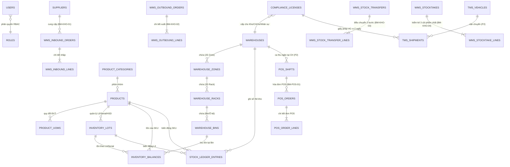

# Thiết kế Cơ sở dữ liệu & Cấu trúc DB (Database Schema & ERD) — QLCH

- **Mã dự án:** `QLCH` — Hệ thống Quản lý Chuỗi Bán lẻ (`POS`), Kho bãi (`WMS`) & Vận chuyển (`TMS`) Hợp nhất
- **Phiên bản:** `1.0` (Thiết kế đầy đủ cho `P1 MVP — Hệ thống Kho bãi WMS, Sơ đồ 2D & An toàn Hàng Đặc thù Cháy nổ/VLNCN/Pháo hoa Z121` + Điểm nối mở rộng `P2 — POS & TMS`)
- **Ngày cập nhật:** `2026-11-14`
- **Người thực hiện:** `Tech Lead`, `Backend Architect` & `Database Optimizer`
- **Trạng thái:** **`Đề xuất trình duyệt Cổng Brief / G1`** (Truy vết 100% tới [`01-quan-ly/DECISIONS.md`](file:///Users/uni/Documents/AI/AI-Workspace/AI-Workspace/TEAM_ORCA/4.Du_an/QLCH/01-quan-ly/DECISIONS.md) `QLCH-D002`, [`02-nghiep-vu/REQUIREMENTS.md`](file:///Users/uni/Documents/AI/AI-Workspace/AI-Workspace/TEAM_ORCA/4.Du_an/QLCH/02-nghiep-vu/REQUIREMENTS.md) và 16 Use Cases tại [`02-nghiep-vu/USE_CASES.md`](file:///Users/uni/Documents/AI/AI-Workspace/AI-Workspace/TEAM_ORCA/4.Du_an/QLCH/02-nghiep-vu/USE_CASES.md))

---

## 1. Chiến lược Lưu trữ & Kiến trúc Cơ sở dữ liệu (`QLCH-D002`)

Tuân thủ nghiêm ngặt quyết định `QLCH-D002` (`Single-owner Multi-branch & Multi-warehouse`, lộ trình `P1 WMS -> P2 POS + TMS`, `Offline-first`, nguyên tắc `$0 First` & `100% Thư viện cục bộ / Local Library-First`), kiến trúc dữ liệu của `QLCH` được thiết kế theo mô hình **2 tầng đồng bộ (Dual-Layer Storage Architecture)**:

| Tầng dữ liệu | Công nghệ đề xuất (`$0 First`) | Vai trò & Phạm vi chịu trách nhiệm |
| :--- | :--- | :--- |
| **1. CSDL Trung tâm (Server / Core Relational DB)** | **PostgreSQL 16+** *(hoặc SQLite/LibSQL ở chế độ Local Standalone khi chạy 1 máy chủ nội bộ)* + **Drizzle ORM / Prisma** | - Nguồn sự thật duy nhất (`Single Source of Truth`) cho toàn chuỗi kho & cửa hàng. - Đảm bảo giao dịch **ACID nghiêm ngặt** cho Sổ cái Thẻ kho (`stock_ledger_entries`), Giá vốn bình quân gia quyền (`MAC`), Khóa chặn trần thuốc nổ quy đổi (`NEQ Hard-Lock`) và Kiểm soát 17 loại Giấy phép pháp lý (`ANTT/PCCC/VLNCN/Pháo`). |
| **2. CSDL Cục bộ tại Thiết bị (`Offline-first Client DB`)** | **IndexedDB (qua thư viện cục bộ `Dexie.js`)** | - Lưu trữ bản sao danh mục `SKU`, `Barcode`, sơ đồ vị trí `Zone/Rack/Bin` và phiếu công việc trực tiếp trên trình duyệt máy quét mã vạch / Mobile / Tablet. - Hỗ trợ nhân viên kho tác nghiệp `Putaway`, `Picking`, `Kiểm kê mù (Blind Count)` trong kho sâu/buồng chống nổ mất sóng (`UC-WMS-09`, `< 1s/lần quét`) và đẩy qua hàng đợi `offline_sync_queue` khi có mạng lại. |

---

## 2. Sơ đồ Quan hệ Thực thể Tổng thể (ERD — `P1 WMS` & Điểm nối `P2 POS/TMS`)

---

## 3. Đặc tả Chi tiết Cấu trúc Bảng (`Database Tables Specification`)

### 3.1. Nhóm 1 — Tổ chức, Đa Kho bãi & Sơ đồ Mặt bằng 2D (`UC-WMS-01`, `FR-WMS-01`, `FR-WMS-02`, `FR-WMS-08`)

#### Bảng 1.1: `warehouses` (Danh mục Kho tổng `Hub/DC`, Kho chi nhánh, Kho chuyên dụng & Cửa hàng)
| Tên cột | Kiểu dữ liệu | Ràng buộc | Mô tả nghiệp vụ & Truy vết |
| :--- | :--- | :--- | :--- |
| `id` | `UUID` | `PK` | Định danh duy nhất của Kho / Điểm lưu trữ |
| `code` | `VARCHAR(32)` | `UNIQUE, NOT NULL` | Mã kho (VD: `KHO-HUB-01`, `KHO-Z121-HN01`, `KHO-VLN-QN01`) |
| `name` | `VARCHAR(150)` | `NOT NULL` | Tên kho / chi nhánh |
| `warehouse_type` | `VARCHAR(32)` | `NOT NULL` | `HUB_DC` (Kho tổng), `BRANCH_STORE` (Kho cửa hàng), `HAZMAT_MAGAZINE` (Kho vật liệu nổ/pháo chuyên dụng), `QUARANTINE` (Kho cách ly chờ hủy) |
| `address` | `TEXT` | `NOT NULL` | Địa chỉ thực tế (kiểm tra khớp địa điểm trên Giấy phép ANTT/PCCC) |
| `is_hazmat_enabled` | `BOOLEAN` | `DEFAULT FALSE` | Kho có lưu trữ hàng đặc thù cháy nổ/VLNCN/Pháo hoa hay không |
| `max_neq_kg` | `NUMERIC(12,3)` | `CHECK (>= 0)` | **Định mức tồn chứa thuốc nổ/thuốc pháo quy đổi tối đa (`Max NEQ/NEW`)** của toàn kho theo Giấy phép ANTT/PCCC (`QCVN 01:2019/BCT`) |
| `current_neq_kg` | `NUMERIC(12,3)` | `DEFAULT 0, CHECK (current_neq_kg <= max_neq_kg)` | Tổng khối lượng `NEQ (kg)` đang tồn thực tế trong kho (ràng buộc `Hard Lock` cấp DB) |
| `grounding_resistance_ohm` | `NUMERIC(6,2)` | `NULL` | Điện trở nối đất hệ thống chống sét gần nhất ($R \le 10\ \Omega$ theo `QCVN 01:2019/BCT`) |
| `max_temp_celsius` | `NUMERIC(5,2)` | `DEFAULT 35.0` | Ngưỡng nhiệt độ bảo quản tối đa cho phép |
| `max_humidity_pct` | `NUMERIC(5,2)` | `DEFAULT 80.0` | Ngưỡng độ ẩm bảo quản tối đa cho phép |
| `layout_2d_config` | `JSONB` | `NOT NULL DEFAULT '{}'` | Cấu hình khung Canvas Sơ đồ 2D của kho (`width_m`, `height_m`, `grid_size`, vị trí tường chắn nổ, bình chữa cháy, tủ điện ngoài kho) |
| `inbound_locked` | `BOOLEAN` | `DEFAULT FALSE` | Tự động `TRUE` nếu Giấy phép ANTT/PCCC của kho hết hạn (`UC-WMS-01 E1`, `UC-WMS-03 E1`) |
| `status` | `VARCHAR(20)` | `DEFAULT 'ACTIVE'` | `ACTIVE`, `LOCKED`, `INACTIVE` |
| `created_at` / `updated_at` | `TIMESTAMPTZ` | `NOT NULL` | Dấu thời gian tạo / cập nhật |

#### Bảng 1.2: `warehouse_zones` (Phân khu / Buồng kho trên Sơ đồ 2D & Cách ly Tương thích — `UC-WMS-01`, `UC-WMS-04`)
| Tên cột | Kiểu dữ liệu | Ràng buộc | Mô tả nghiệp vụ & Truy vết |
| :--- | :--- | :--- | :--- |
| `id` | `UUID` | `PK` | Định danh Khu vực / Buồng kho (`Zone`) |
| `warehouse_id` | `UUID` | `FK -> warehouses.id` | Thuộc Kho nào |
| `zone_code` | `VARCHAR(32)` | `NOT NULL` | Mã phân khu (VD: `ZONE-A-THUOCNO`, `ZONE-B-KIPNO`, `ZONE-C-Z121`, `ZONE-D-FMCG`) |
| `name` | `VARCHAR(120)` | `NOT NULL` | Tên khu vực / buồng chứa |
| `compatibility_group` | `VARCHAR(40)` | `NOT NULL` | Nhóm tương thích lưu trữ (`GENERAL_GOODS`, `EXPLOSIVE_MAIN` [Thuốc nổ], `DETONATOR_INITIATOR` [Kíp nổ/Phụ kiện nổ], `PRECURSOR_AN` [Amoni Nitrat], `FIREWORKS_1_4G` [Pháo hoa Z121], `FLAMMABLE_CHEM` [Dầu mỡ/Axít/Dung môi], `QUARANTINE_DAMAGED` [Hàng hỏng/ẩm ướt chờ hủy]) |
| `max_neq_kg` | `NUMERIC(12,3)` | `CHECK (>= 0)` | Định mức `NEQ (kg)` tối đa cho phép trong riêng buồng kho này |
| `current_neq_kg` | `NUMERIC(12,3)` | `DEFAULT 0, CHECK (current_neq_kg <= max_neq_kg)` | Khối lượng `NEQ (kg)` hiện tại trong buồng kho |
| `pos_2d_x` / `pos_2d_y` | `NUMERIC(8,2)` | `NOT NULL` | Tọa độ $(X, Y)$ trên Sơ đồ mặt bằng kho 2D (`FR-WMS-02`) |
| `width_2d` / `height_2d` | `NUMERIC(8,2)` | `NOT NULL` | Kích thước khối `Zone` trên Sơ đồ 2D |
| `color_hex` | `VARCHAR(16)` | `DEFAULT '#3B82F6'` | Màu hiển thị mặc định trên Sơ đồ 2D |

#### Bảng 1.3: `warehouse_racks` (Dãy / Kệ / Pallet trên Sơ đồ 2D) & Bảng 1.4: `warehouse_bins` (Tầng / Ô chứa gắn Mã vạch)
- **`warehouse_racks`**: `id (PK)`, `zone_id (FK -> warehouse_zones.id)`, `rack_code`, `name`, `pos_2d_x`, `pos_2d_y`, `width_2d`, `height_2d`, `rotation_deg`, `levels_count`.
- **`warehouse_bins`**: `id (PK)`, `rack_id (FK -> warehouse_racks.id)`, `warehouse_id (FK)`, `zone_id (FK)`, `bin_code (UNIQUE per warehouse, VD: 'ZA-R01-L02-B04')`, `barcode (UNIQUE, dùng để súng bắn mã vạch quét < 1s)`, `level_no`, `max_weight_kg`, `max_volume_cbm`, `is_quarantine_bin (BOOLEAN)`, `status ('ACTIVE' | 'FULL' | 'LOCKED')`.

#### Bảng 1.5: `roles` & `users` (Nhân sự, Phân quyền RBAC & Xác thực 2 lớp PIN/OTP)
- **`roles`**: `id (PK)`, `role_code ('ACT_OWN' | 'ACT_WM' | 'ACT_WS' | 'ACT_ACC' | 'ACT_POS' | 'ACT_TMS')`, `permissions (JSONB)`.
- **`users`**: `id (PK)`, `username (UNIQUE)`, `full_name`, `phone`, `cccd_12 (VARCHAR(12))`, `role_id (FK)`, `assigned_warehouse_id (FK)`, `password_hash`, `approval_pin_hash` *(Mã PIN xác thực 2 lớp khi duyệt xuất kho đặc thù, xuất hủy hoặc duyệt cân bằng kiểm kê theo `FR-WMS-09`)*, `has_valid_safety_cert (BOOLEAN — tự động cập nhật từ bảng giấy phép `compliance_licenses`)`, `status`.

---

### 3.2. Nhóm 2 — Danh mục Hàng hóa, Đa ĐVT, Lô/Serial/HSD & Thuộc tính Hàng Cháy nổ (`UC-WMS-02`, `FR-WMS-03`, `FR-WMS-08`)

#### Bảng 2.1: `products` (Danh mục Hàng hóa `SKU` Đa ngành & Metadata Hàng Đặc thù)
| Tên cột | Kiểu dữ liệu | Ràng buộc | Mô tả nghiệp vụ & Truy vết |
| :--- | :--- | :--- | :--- |
| `id` | `UUID` | `PK` | Định danh sản phẩm |
| `sku` | `VARCHAR(64)` | `UNIQUE, NOT NULL` | Mã `SKU` chuẩn |
| `barcode` | `VARCHAR(64)` | `UNIQUE, NOT NULL` | Mã vạch / QR tiêu chuẩn của đơn vị cơ sở (`EAN-13 / Code-128 / QR`) |
| `name` | `VARCHAR(255)` | `NOT NULL` | Tên hàng hóa, quy cách |
| `category_id` | `UUID` | `FK -> product_categories.id` | Nhóm ngành hàng |
| `manufacturer` | `VARCHAR(150)` | `NULL` | Nhà sản xuất (VD: `Nhà máy Z121 - Bộ Quốc phòng`, `Tổng công ty CN Hóa chất mỏ MICCO`...) |
| `base_uom` | `VARCHAR(32)` | `NOT NULL` | Đơn vị tính cơ sở lưu kho (VD: `Hộp`, `Giàn`, `Kg`, `Kíp`, `Chai`) |
| `regulatory_type` | `VARCHAR(32)` | `NOT NULL DEFAULT 'TYPE_0_GENERAL'` | Phân loại quản lý pháp lý (`UC-WMS-02`): - `TYPE_0_GENERAL`: Hàng tiêu dùng/bán lẻ thông thường - `TYPE_1A_EXPLOSIVE`: Vật liệu nổ công nghiệp (Thuốc nổ / Kíp nổ / Dây nổ) - `TYPE_1B_PRECURSOR`: Tiền chất thuốc nổ (`Amoni Nitrat >= 98.5%`...) - `TYPE_2_FIREWORKS_Z121`: Pháo hoa tiêu dùng không tiếng nổ (`Z121` — Nghị định `137/2020/NĐ-CP`) - `TYPE_3_HAZMAT_CHEM`: Hóa chất nguy hiểm / Chất dễ cháy nổ (`LPG`, Dung môi...) |
| `un_number` | `VARCHAR(16)` | `NULL` | Mã số Liên Hợp Quốc (VD: `UN 0336` cho Pháo hoa 1.4G, `UN 1942` cho Amoni Nitrat) |
| `hazard_division` | `VARCHAR(16)` | `NULL` | Nhóm nguy hiểm (`1.1D`, `1.1B`, `1.3G`, `1.4G`, `2.1`, `3`, `5.1`...) |
| `incompatibility_group` | `VARCHAR(40)` | `NOT NULL DEFAULT 'COMPAT_GENERAL'` | Nhóm kỵ lưu trữ dùng để kiểm tra cách ly tự động với `warehouse_zones.compatibility_group` (`EXPLOSIVE_MAIN`, `DETONATOR_INITIATOR`, `PRECURSOR_AN`, `FIREWORKS_1_4G`, `FLAMMABLE_OIL_ACID`) |
| `unit_neq_kg` | `NUMERIC(10,4)` | `DEFAULT 0, CHECK (>= 0)` | **Định lượng thuốc nổ/thuốc pháo quy đổi trên 1 đơn vị cơ sở (`Unit NEQ/NEW` tính bằng `kg`)** |
| `track_lot_expiry` | `BOOLEAN` | `DEFAULT FALSE` | Bắt buộc `TRUE` đối với hàng thực phẩm/dược phẩm và mọi hàng `TYPE_1A..TYPE_3` |
| `track_serial` | `BOOLEAN` | `DEFAULT FALSE` | Quản lý đến từng Số Sê-ri thùng/hộp (`Serial`) đối với `VLNCN` và `Pháo hoa Z121` |
| `picking_strategy` | `VARCHAR(16)` | `DEFAULT 'FEFO'` | Chiến lược xuất kho tự động: `FEFO` (Hết hạn trước xuất trước) hoặc `FIFO` (Nhập trước xuất trước) |
| `mac_cost_price` | `NUMERIC(18,2)` | `DEFAULT 0` | **Giá vốn bình quân gia quyền hiện tại (`Moving Average Cost - MAC`)** trên 1 `base_uom` |
| `retail_price` | `NUMERIC(18,2)` | `DEFAULT 0` | Giá bán lẻ tiêu chuẩn |
| `regulated_ceiling_price` | `NUMERIC(18,2)` | `NULL` | **Giá bán lẻ niêm yết trần (`Ceiling Price`)** — khóa chặn không cho phép bán vượt giá trần đối với Pháo hoa `Z121` (`UC-POS-03`) |
| `min_stock_qty` / `max_stock_qty` | `NUMERIC(14,2)` | `DEFAULT 0` | Định mức tồn tối thiểu / tối đa để phát cảnh báo (`FR-WMS-06`) |

#### Bảng 2.2: `product_uoms` (Bảng Quy đổi Đa Đơn vị tính — `Multi-UoM`)
- `id (PK)`, `product_id (FK -> products.id)`, `uom_name` (VD: `Thùng`, `Lốc`), `barcode (UNIQUE)`, `conversion_factor (NUMERIC(12,4) NOT NULL CHECK (> 0))` *(Hệ số quy đổi ra `base_uom`, VD: `1 Thùng = 20 Giàn`)*.

#### Bảng 2.3: `inventory_lots` (Danh mục Lô sản xuất, Sê-ri Thùng & Hạn sử dụng — `Batch / Lot / Serial`)
- `id (PK)`, `product_id (FK -> products.id)`, `lot_number (VARCHAR(64) NOT NULL)`, `serial_no (VARCHAR(64) NULL)`, `mfg_date (DATE NOT NULL)`, `expiry_date (DATE NOT NULL)`, `supplier_id (FK)`, `origin_transport_permit_no (VARCHAR(64))`, `status ('ACTIVE' | 'NEAR_EXPIRY' | 'EXPIRED' | 'QUARANTINED')`.
- `UNIQUE (product_id, lot_number, COALESCE(serial_no, ''))`.

---

### 3.3. Nhóm 3 — Hồ sơ 17 loại Giấy phép Pháp lý & Tuân thủ An toàn (`UC-WMS-03`, `FR-WMS-09`)

#### Bảng 3.1: `compliance_licenses` (Sổ đăng ký 17 loại Giấy phép / GCN / Chứng chỉ Pháp lý)
| Tên cột | Kiểu dữ liệu | Ràng buộc | Mô tả nghiệp vụ & Truy vết |
| :--- | :--- | :--- | :--- |
| `id` | `UUID` | `PK` | Định danh hồ sơ giấy phép |
| `license_type_code` | `VARCHAR(40)` | `NOT NULL` | Mã chuẩn 1 trong **17 loại giấy phép** (`REF-MKT-005` Mục 3): - Nhóm I (`GP-01` ĐKKD, `GP-02` **GCN ANTT C06/PC06**, `GP-03` Phương án ANTT) - Nhóm II (`GP-04` Thẩm duyệt PCCC, `GP-05` **Nghiệm thu PCCC C07/PC07**, `GP-06` GP Môi trường) - Nhóm III (`GP-07` GP KD Pháo hoa BQP, `GP-08` Chấp thuận điểm bán Pháo Z121, `GP-09` GP KD/SD VLNCN, `GP-10` GCN Bảo quản VLNCN Sở CT) - Nhóm IV (`GP-11` **GP Vận chuyển Pháo hoa C06 $\le 7$ ngày**, `GP-12` **GP Vận chuyển Hàng nguy hiểm Loại 1 C07/PC07**, `GP-13` Kiểm định xe Hàng nguy hiểm) - Nhóm V (`GP-14` Chứng chỉ PCCC nhân sự 5 năm, `GP-15` Huấn luyện AT VLNCN 2 năm, `GP-16` Tập huấn VC hàng nguy hiểm 2 năm, `GP-17` Chứng chỉ Thợ/Chỉ huy nổ mìn) |
| `license_no` | `VARCHAR(80)` | `NOT NULL` | Số hiệu văn bản / giấy phép |
| `issuing_authority` | `VARCHAR(150)` | `NOT NULL` | Cơ quan cấp (`Cục C06`, `Cục C07`, `PC06`, `PC07`, `Sở Công Thương`, `Bộ Quốc phòng`...) |
| `target_entity_type` | `VARCHAR(32)` | `NOT NULL` | Đối tượng được cấp phép: `WAREHOUSE`, `VEHICLE`, `USER`, `CUSTOMER_B2B`, `SHIPMENT` |
| `target_entity_id` | `UUID` | `NOT NULL` | Khóa tham chiếu tới thực thể tương ứng |
| `licensed_max_neq_kg` | `NUMERIC(12,3)` | `NULL` | Hạn mức `NEQ (kg)` hoặc hạn mức nổ mìn được cấp trên giấy phép |
| `remaining_quota_qty` | `NUMERIC(14,3)` | `NULL` | Hạn mức còn lại (dùng khi trừ dần hạn mức Giấy phép sử dụng `VLNCN` của khách hàng B2B tại `UC-WMS-05`) |
| `issue_date` | `DATE` | `NOT NULL` | Ngày cấp |
| `expiry_date` | `DATE` | `NOT NULL` | Ngày hết hạn (Hệ thống quét cảnh báo Vàng trước `60 ngày`, Đỏ trước `30 ngày`) |
| `return_due_date` | `DATE` | `NULL` | Hạn phải nộp trả giấy phép gốc cho Công an (áp dụng cho `GP-11`, `GP-12`: trong vòng `07 ngày` sau chuyến vận chuyển — `UC-TMS-03`) |
| `is_returned_to_police` | `BOOLEAN` | `DEFAULT FALSE` | Đã hoàn trả giấy phép vận chuyển cho cơ quan Công an hay chưa |
| `attachment_local_path` | `TEXT` | `NULL` | Đường dẫn file scan PDF/Ảnh lưu trữ nội bộ |
| `status` | `VARCHAR(24)` | `NOT NULL` | `VALID`, `EXPIRING_SOON_60D`, `EXPIRING_CRITICAL_30D`, `EXPIRED_LOCKED`, `REVOKED` |

---

### 3.4. Nhóm 4 — Tồn kho Đa trạng thái & Sổ cái Thẻ kho Bất biến (`UC-WMS-04..08`, `FR-WMS-04..07`)

#### Bảng 4.1: `inventory_balances` (Tồn kho Tức thời theo `Kho + Bin + SKU + Lô + Phẩm chất`)
| Tên cột | Kiểu dữ liệu | Ràng buộc | Mô tả nghiệp vụ & Truy vết |
| :--- | :--- | :--- | :--- |
| `id` | `UUID` | `PK` | Định danh bản ghi tồn kho |
| `warehouse_id` | `UUID` | `FK -> warehouses.id` | Kho lưu trữ |
| `zone_id` | `UUID` | `FK -> warehouse_zones.id` | Phân khu / Buồng kho (để tổng hợp nhanh `NEQ` và kiểm tra cách ly) |
| `bin_id` | `UUID` | `FK -> warehouse_bins.id` | Vị trí ô kệ cụ thể (`Bin`) |
| `product_id` | `UUID` | `FK -> products.id` | Mặt hàng (`SKU`) |
| `lot_id` | `UUID` | `FK -> inventory_lots.id` | Lô / Serial cụ thể |
| `quality_status` | `VARCHAR(24)` | `NOT NULL DEFAULT 'GOOD_100'` | 3 cột phẩm chất chuẩn `Mẫu số 05-VT` (`UC-WMS-07`): - `GOOD_100`: Còn tốt 100% - `DEGRADED`: Kém phẩm chất (móp vỏ, cận date) - `DAMAGED_QUARANTINE`: Mất phẩm chất / Ẩm ướt / Hư hỏng (bắt buộc nằm tại `Bin` cách ly chờ hủy) |
| `on_hand_qty` | `NUMERIC(14,3)` | `NOT NULL DEFAULT 0, CHECK (>= 0)` | **Tồn thực tế trong kho (`On-hand`)** tính theo `base_uom` |
| `reserved_qty` | `NUMERIC(14,3)` | `NOT NULL DEFAULT 0, CHECK (>= 0)` | **Tồn giữ chỗ (`Reserved`)** cho các phiếu xuất/điều chuyển đã duyệt chờ lấy hàng |
| `in_transit_qty` | `NUMERIC(14,3)` | `NOT NULL DEFAULT 0, CHECK (>= 0)` | **Tồn đang đi đường (`In-Transit`)** khi điều chuyển liên kho (`UC-WMS-06`) |
| `available_qty` | `NUMERIC(14,3)` | `GENERATED ALWAYS AS (on_hand_qty - reserved_qty) STORED, CHECK (>= 0)` | **Tồn khả dụng (`Available = On-hand - Reserved`)** |
| `total_neq_kg` | `NUMERIC(12,3)` | `NOT NULL DEFAULT 0, CHECK (>= 0)` | Tổng khối lượng thuốc nổ quy đổi của dòng tồn này (`on_hand_qty * unit_neq_kg`) |
| `updated_at` | `TIMESTAMPTZ` | `NOT NULL` | Thời điểm biến động gần nhất |

> **Ràng buộc Unique:** `UNIQUE (warehouse_id, bin_id, product_id, lot_id, quality_status)`.

#### Bảng 4.2: `stock_ledger_entries` (Sổ cái Thẻ kho Bất biến — `Immutable Append-Only Stock Card` — `FR-WMS-07`, `UC-WMS-08`)
> **Nguyên tắc bất biến:** Bảng này **CHỈ CHO PHÉP `INSERT` (`Append-only`)**, tuyệt đối cấm `UPDATE` hoặc `DELETE` để phục vụ thanh tra hậu kiểm của Cục `C06`, `C07` và Sở Công Thương.

| Tên cột | Kiểu dữ liệu | Ràng buộc | Mô tả nghiệp vụ & Truy vết |
| :--- | :--- | :--- | :--- |
| `id` | `BIGSERIAL` / `UUID` | `PK` | Số thứ tự bút toán thẻ kho tuần tự |
| `transaction_code` | `VARCHAR(40)` | `UNIQUE, NOT NULL` | Mã bút toán sổ cái |
| `warehouse_id` | `UUID` | `FK -> warehouses.id` | Kho phát sinh |
| `bin_id` | `UUID` | `FK -> warehouse_bins.id` | Vị trí `Bin` phát sinh |
| `product_id` | `UUID` | `FK -> products.id` | Mặt hàng (`SKU`) |
| `lot_id` | `UUID` | `FK -> inventory_lots.id` | Lô / Serial |
| `movement_type` | `VARCHAR(32)` | `NOT NULL` | `INBOUND_RECEIPT` (Nhập kho), `OUTBOUND_ISSUE` (Xuất bán/nội bộ), `OUTBOUND_DESTROY` (Xuất tiêu hủy), `TRANSFER_OUT` (Xuất điều chuyển sang In-Transit), `TRANSFER_IN` (Nhận điều chuyển), `STOCKTAKE_GAIN` (Kiểm kê thừa), `STOCKTAKE_LOSS` (Kiểm kê thiếu), `POS_SALE` (Bán lẻ P2), `POS_RETURN` (Khách trả hàng P2) |
| `ref_doc_type` | `VARCHAR(32)` | `NOT NULL` | Loại chứng từ gốc (`BM_KHO_01`, `BM_KHO_02`, `BM_KHO_03`, `BM_KHO_04`, `BM_POS_01`, `BM_POS_02`) |
| `ref_doc_id` | `UUID` | `NOT NULL` | ID chứng từ gốc |
| `ref_doc_no` | `VARCHAR(50)` | `NOT NULL` | Số hiệu phiếu (VD: `PNK-202611-0001`) |
| `permit_license_no` | `VARCHAR(80)` | `NULL` | Số Giấy phép vận chuyển / Giấy phép sử dụng `VLNCN` hoặc số CCCD người mua đi kèm giao dịch |
| `qty_before` | `NUMERIC(14,3)` | `NOT NULL` | Số lượng tồn trước giao dịch |
| `qty_change` | `NUMERIC(14,3)` | `NOT NULL` | Số lượng biến động (`+` tăng / `-` giảm) theo `base_uom` |
| `qty_after` | `NUMERIC(14,3)` | `NOT NULL, CHECK (qty_after = qty_before + qty_change AND qty_after >= 0)` | Số lượng tồn sau giao dịch (bắt buộc khớp phương trình Thẻ kho) |
| `neq_change_kg` | `NUMERIC(12,3)` | `NOT NULL DEFAULT 0` | Biến động khối lượng thuốc nổ quy đổi `NEQ (kg)` |
| `mac_cost_before` | `NUMERIC(18,2)` | `NOT NULL` | Giá vốn `MAC` trước giao dịch |
| `unit_price` | `NUMERIC(18,2)` | `NOT NULL` | Đơn giá giao dịch |
| `mac_cost_after` | `NUMERIC(18,2)` | `NOT NULL` | Giá vốn `MAC` sau giao dịch |
| `performed_by` | `UUID` | `FK -> users.id` | Nhân viên thực hiện |
| `approved_by` | `UUID` | `FK -> users.id NULL` | Người phê duyệt (Quản lý kho / Chủ chuỗi) |
| `two_factor_verified` | `BOOLEAN` | `DEFAULT FALSE` | Đã xác thực PIN/OTP 2 lớp hay chưa (bắt buộc `TRUE` với xuất hủy, cân bằng kiểm kê, xuất VLNCN) |
| `created_at` | `TIMESTAMPTZ` | `NOT NULL DEFAULT NOW()` | Thời điểm ghi sổ bất biến |

---

### 3.5. Nhóm 5 — Hệ thống Chứng từ Giao dịch Kho `P1 WMS` (`BM-KHO-01..04` — `UC-WMS-04..07`)

1. **`wms_inbound_orders` & `wms_inbound_lines` (`BM-KHO-01` — Phiếu Nhập Kho Mẫu `01-VT` — `UC-WMS-04`)**:
   - **Header (`wms_inbound_orders`)**: `id (PK)`, `order_no (UNIQUE)`, `warehouse_id (FK)`, `supplier_id (FK)`, `invoice_no`, `invoice_date`, `transport_license_id (FK -> compliance_licenses.id NULL)`, `vehicle_plate_no`, `driver_name`, `driver_cccd`, `total_doc_qty`, `total_actual_qty`, `total_neq_added_kg`, `subtotal_amount`, `discount_amount`, `vat_amount`, `allocated_fee_amount`, `total_amount`, `status ('DRAFT' | 'RECEIVING' | 'COMPLETED' | 'CANCELLED')`, `created_by`, `approved_by`, `completed_at`.
   - **Lines (`wms_inbound_lines`)**: `id (PK)`, `inbound_order_id (FK)`, `product_id (FK)`, `lot_id (FK)`, `target_bin_id (FK -> warehouse_bins.id)`, `uom_name`, `conversion_factor`, `doc_qty (SL theo chứng từ)`, `actual_qty (SL thực nhập)`, `base_actual_qty`, `line_neq_kg`, `unit_price`, `allocated_fee`, `mac_cost_calculated`, `putaway_scanned_at`, `putaway_scanned_by`.

2. **`wms_outbound_orders` & `wms_outbound_lines` (`BM-KHO-02` — Phiếu Xuất Kho Mẫu `02-VT` — `UC-WMS-05`)**:
   - **Header (`wms_outbound_orders`)**: `id (PK)`, `order_no (UNIQUE)`, `warehouse_id (FK)`, `outbound_reason ('SALE_B2B' | 'RETURN_SUPPLIER' | 'INTERNAL_USE' | 'DESTROY_HAZMAT')`, `customer_b2b_id (UUID NULL)`, `b2b_explosive_License_id (FK -> compliance_licenses.id NULL — kiểm tra hạn mức nổ mìn còn lại)`, `transport_license_id (FK -> compliance_licenses.id NULL)`, `vehicle_plate_no`, `receiver_name`, `receiver_cccd_12`, `escort_name`, `escort_cert_no`, `total_neq_reduced_kg`, `two_factor_auth_log (JSONB — lưu vết xác thực PIN 2 lớp khi xuất VLNCN / xuất hủy)`, `status ('DRAFT' | 'RESERVED_PICKING' | 'COMPLETED' | 'CANCELLED')`, `created_by`, `approved_by`, `completed_at`.
   - **Lines (`wms_outbound_lines`)**: `id (PK)`, `outbound_order_id (FK)`, `product_id (FK)`, `lot_id (FK — chỉ định theo FEFO/FIFO)`, `source_bin_id (FK -> warehouse_bins.id)`, `requested_qty`, `actual_picked_qty`, `base_picked_qty`, `mac_cost_unit`, `total_cost_amount`, `picked_scanned_at`, `picked_scanned_by`.

3. **`wms_stock_transfers` & `wms_stock_transfer_lines` (`BM-KHO-03` — Phiếu Điều chuyển Liên kho 2 Bước `In-Transit` — `UC-WMS-06`)**:
   - **Header (`wms_stock_transfers`)**: `id (PK)`, `transfer_no (UNIQUE)`, `from_warehouse_id (FK)`, `to_warehouse_id (FK)`, `transport_license_id (FK -> compliance_licenses.id — bắt buộc còn hạn <= 7 ngày nếu chuyển pháo/VLNCN)`, `vehicle_id (FK)`, `driver_user_id (FK)`, `escort_user_id (FK)`, `seal_no (VARCHAR(64) — Mã số kẹp chì niêm phong lúc xuất)`, `received_seal_intact (BOOLEAN — Xác nhận kẹp chì nguyên vẹn lúc nhận)`, `total_neq_transit_kg`, `status ('DRAFT' | 'IN_TRANSIT' | 'RECEIVED_PARTIAL_DISCREPANCY' | 'COMPLETED' | 'CANCELLED')`, `shipped_by`, `shipped_at`, `received_by`, `received_at`.
   - **Lines (`wms_stock_transfer_lines`)**: `id (PK)`, `transfer_id (FK)`, `product_id (FK)`, `lot_id (FK)`, `from_bin_id (FK)`, `to_bin_id (FK NULL)`, `shipped_qty (SL Xuất chuyển -> cộng vào In-Transit)`, `received_qty (SL Thực nhận tại kho đích)`, `discrepancy_qty (GENERATED ALWAYS AS (received_qty - shipped_qty) STORED)`, `discrepancy_reason`.

4. **`wms_stocktakes` & `wms_stocktake_lines` (`BM-KHO-04` — Biên bản Kiểm kê Kho Mẫu `05-VT` — `UC-WMS-07`)**:
   - **Header (`wms_stocktakes`)**: `id (PK)`, `stocktake_no (UNIQUE)`, `warehouse_id (FK)`, `scope_zone_id (FK NULL)`, `is_blind_count (BOOLEAN DEFAULT TRUE — ẩn số tồn sổ sách khi nhân viên đếm)`, `snapshot_at`, `two_factor_approved_by (FK -> users.id)`, `two_factor_approved_at`, `status ('SNAPSHOT_OPEN' | 'COUNTING' | 'PENDING_APPROVAL' | 'BALANCED_COMPLETED' | 'CANCELLED')`.
   - **Lines (`wms_stocktake_lines`)**: `id (PK)`, `stocktake_id (FK)`, `bin_id (FK)`, `product_id (FK)`, `lot_id (FK)`, `system_snapshot_qty (Tồn sổ sách lúc chụp)`, `actual_good_qty (Cột 1: Còn tốt 100%)`, `actual_degraded_qty (Cột 2: Kém phẩm chất)`, `actual_damaged_qty (Cột 3: Mất phẩm chất/Ẩm ướt chờ hủy)`, `total_counted_qty`, `diff_qty`, `diff_neq_kg`, `diff_mac_value`, `adjustment_reason`.

---

### 3.6. Nhóm 6 — Cấu trúc CSDL Cục bộ `Offline-first` (`IndexedDB / Dexie.js Schema` — `UC-WMS-09`, `NFR-QLCH-02`)

Để đảm bảo nhân viên kho làm việc mượt mà trong các buồng kho cách ly chống nổ tường dày hoặc góc khuất mất sóng Wi-Fi/4G (`< 1 giây/thao tác quét mã vạch`), trình duyệt thiết bị khởi tạo CSDL cục bộ `IndexedDB` (`qlch_offline_db`) gồm 5 Object Stores:

| Tên Store (`IndexedDB`) | Khóa chính & Chỉ mục (`Dexie.js Index Spec`) | Mục đích sử dụng khi Offline |
| :--- | :--- | :--- |
| `local_products_cache` | `id, &sku, &barcode, regulatory_type, incompatibility_group` | Tra cứu tức thời `< 50ms` thông tin `SKU`, quy đổi ĐVT, `unit_neq_kg` và nhóm kỵ lưu trữ khi bắn mã vạch ngoại tuyến. |
| `local_bins_2d_cache` | `id, warehouse_id, zone_id, &bin_code, &barcode, compatibility_group, max_neq_kg, current_neq_kg` | Hiển thị Sơ đồ kho 2D ngoại tuyến và kiểm tra tức thời tại máy cầm tay: nếu quét nhầm `Kíp nổ` vào `Bin` thuộc `Zone Thuốc nổ` hoặc vượt `Max NEQ`, máy cầm tay báo còi đỏ chặn ngay cả khi đang Offline. |
| `local_lots_cache` | `id, product_id, lot_number, serial_no, expiry_date` | Kiểm tra hạn sử dụng `FEFO/FIFO` và xác thực đúng `Số Lô / Serial thùng` ngoại tuyến. |
| `local_active_tasks` | `id, task_type, ref_doc_no, warehouse_id, status` | Lưu các phiếu `Putaway`, `Picking`, `Kiểm kê mù (Blind Count)` đã tải xuống thiết bị trước khi đi vào khu vực mất sóng. |
| `offline_sync_queue` | `++local_seq, &idempotency_key, event_type, ref_doc_id, scanned_at, sync_status` | Hàng đợi sự kiện bất biến lưu từng thao tác quét mã vạch ngoại tuyến kèm `UUID v7 (idempotency_key)`. Tự động đẩy lên Server theo đúng thứ tự `local_seq` khi có mạng lại; nếu phát hiện xung đột tồn kho hoặc vượt trần `NEQ` do người khác vừa nhập, đánh dấu `CONFLICT_REQUIRES_REVIEW` để Thủ kho xử lý. |

---

### 3.7. Nhóm 7 — Điểm nối Mở rộng Giai đoạn 2 (`P2 Extension Points: POS & TMS` — `BR-QLCH-02`, `UC-POS-01..04`, `UC-TMS-01..03`)

Các bảng Giai đoạn 2 được thiết kế sẵn khóa ngoại nối trực tiếp vào `warehouses`, `products`, `inventory_lots`, `compliance_licenses` và `stock_ledger_entries` của `P1`:
1. **Phân hệ Bán lẻ `POS` (`UC-POS-01..04`)**:
   - **`pos_shifts` (`BM-POS-03` — Ca thu ngân & Kết ca mù)**: `id (PK)`, `shift_code`, `store_warehouse_id (FK -> warehouses.id)`, `cashier_id (FK -> users.id)`, `opening_cash`, `system_expected_cash`, `blind_declared_cash (Tiền mặt thu ngân tự đếm nhập mù)`, `cash_discrepancy`, `status ('OPEN' | 'CLOSED_BALANCED' | 'CLOSED_DISCREPANCY')`.
   - **`pos_orders` & `pos_order_lines` (`BM-POS-01` & `UC-POS-03` — Bán lẻ & Bán Pháo hoa `Z121` / `VLNCN`)**:
     - Header lưu `order_no`, `shift_id (FK)`, `store_warehouse_id (FK)`, `payment_method ('CASH' | 'VIETQR_LOCAL' | 'MIXED')`, và cụm trường định danh bắt buộc khi giỏ hàng có Pháo hoa `Z121` (`Nghị định 137/2020/NĐ-CP`): **`buyer_full_name`, `buyer_cccd_12 (CHECK length = 12)`, `buyer_dob (CHECK đủ >= 18 tuổi)`, `buyer_address`, `buyer_phone`**.
     - Lines lưu `product_id (FK)`, `lot_id (FK — bắt buộc chọn đúng Số Lô pháo Z121)`, `qty`, `unit_price (CHECK <= regulated_ceiling_price nếu là Pháo Z121)`. Khi hoàn tất đơn, tự động ghi bút toán `POS_SALE` vào `stock_ledger_entries`.
   - **`pos_returns` (`BM-POS-02` — Đổi/Trả hàng tại quầy)**: `id (PK)`, `original_pos_order_id (FK — bắt buộc tham chiếu hóa đơn gốc)`, `return_condition ('GOOD_RESELLABLE' | 'DEFECTIVE_QUARANTINE')`, tự động hoàn tồn vào `Kho Hàng Tốt` hoặc `Kho Cách ly Chờ hủy` (`UC-POS-04`).
2. **Phân hệ Vận chuyển `TMS` (`UC-TMS-01..03`)**:
   - **`tms_vehicles` (Đội xe chuyên dụng Hàng nguy hiểm Loại 1)**: `id (PK)`, `plate_no (UNIQUE)`, `vehicle_class`, `un_hazard_placard_code`, `has_spark_arrestor (BOOLEAN)`, `has_grounding_chain (BOOLEAN)`, `inspection_license_id (FK -> compliance_licenses.id)`, `status`.
   - **`tms_shipments` (Vận đơn & Giám sát Giấy phép Vận chuyển $\le 7$ ngày)**: `id (PK)`, `shipment_no (UNIQUE)`, `source_transfer_id (FK -> wms_stock_transfers.id NULL)`, `source_outbound_id (FK -> wms_outbound_orders.id NULL)`, `vehicle_id (FK)`, `driver_id (FK -> users.id)`, `escort_id (FK -> users.id — Người áp tải bắt buộc với VLNCN/Pháo)`, `transport_license_id (FK -> compliance_licenses.id — Giấy phép C06/PC07 cấp từng chuyến <= 7 ngày)`, `approved_route_2d (JSONB)`, `seal_no`, `cod_amount`, `cod_collected_amount`, `pod_signed_by`, `pod_photo_local_path`, `license_return_deadline (DATE — hạn 7 ngày phải nộp trả giấy phép cho Công an)`, `status`.

---

## 4. Năm Bất biến Cơ sở dữ liệu Bắt buộc (`Mandatory Database Invariants`)

Hệ thống CSDL cài đặt **5 quy tắc bất biến cấp độ Database Constraint & Transaction Trigger** (kiểm chứng tự động bởi `QA Lead` ở `QUALITY_AND_RELEASE.md`):

1. **`INV-DB-01` — Bất biến Không âm Tồn kho (`Non-Negative Inventory Constraint`)**:
   - Mọi dòng trong `inventory_balances` luôn thỏa mãn `on_hand_qty >= 0`, `reserved_qty >= 0`, `available_qty = on_hand_qty - reserved_qty >= 0`. Bất kỳ giao dịch nào làm âm tồn kho đều bị `ROLLBACK` ngay lập tức.
2. **`INV-DB-02` — Bất biến Khóa chặn Trần Thuốc nổ Quy đổi (`NEQ Capacity Hard-Lock` — `QCVN 01:2019/BCT`)**:
   - Trước khi `COMMIT` bất kỳ lệnh Nhập kho (`UC-WMS-04`), Nhận điều chuyển (`UC-WMS-06`) hoặc Kiểm kê thừa (`UC-WMS-07`), Trigger CSDL kiểm tra:
     $$\sum \text{total\_neq\_kg (Zone)} \le \text{warehouse\_zones.max\_neq\_kg} \quad \text{và} \quad \sum \text{total\_neq\_kg (Warehouse)} \le \text{warehouses.max\_neq\_kg}$$
   - Nếu vượt định mức cấp phép trên Giấy phép ANTT/PCCC, CSDL ném lỗi `ERR_NEQ_LIMIT_EXCEEDED` và `ROLLBACK` toàn bộ giao dịch.
3. **`INV-DB-03` — Bất biến Cách ly Hàng Kỵ nhau (`Incompatible Hazard Separation` — `QCVN 01:2019/BCT`)**:
   - Trigger kiểm tra khi gán `bin_id` trong `inventory_balances`: Tuyệt đối chặn không cho phép `products.incompatibility_group = 'DETONATOR_INITIATOR'` (Kíp nổ) nằm chung `zone_id` với `'EXPLOSIVE_MAIN'` (Thuốc nổ), hoặc `'PRECURSOR_AN'` (Amoni Nitrat) nằm chung `zone_id` với `'FLAMMABLE_OIL_ACID'` (Xăng dầu/Axít).
4. **`INV-DB-04` — Bất biến Khóa Tuân thủ Giấy phép Hết hạn (`Compliance License Expiration Lock`)**:
   - Không cho phép tạo/hoàn tất giao dịch Nhập/Xuất/Vận chuyển hàng đặc thù (`TYPE_1A`, `TYPE_1B`, `TYPE_2`, `TYPE_3`) nếu `Kho`, `Xe` hoặc `Nhân sự (Thủ kho/Lái xe/Áp tải)` có giấy phép bắt buộc trong `compliance_licenses` ở trạng thái `EXPIRED_LOCKED` (`expiry_date < CURRENT_DATE`).
5. **`INV-DB-05` — Bất biến Cân bằng Sổ cái Thẻ kho (`Stock Ledger Balance Equation`)**:
   - Tại mọi thời điểm, với mọi `(warehouse_id, bin_id, product_id, lot_id)`:
     $$\text{inventory\_balances.on\_hand\_qty} \equiv \sum (\text{stock\_ledger\_entries.qty\_change})$$

---

## 5. Chiến lược Đánh chỉ mục (Indexing) & Lộ trình Triển khai DB (`DB Tasks`)

### 5.1. Danh mục Chỉ mục Hiệu năng cao (`Performance Indexes` đảm bảo `< 1s/lần quét`)
- `idx_products_barcode`: `UNIQUE INDEX ON products(barcode)` và `product_uoms(barcode)` — phục vụ súng bắn mã vạch tra cứu tức thời.
- `idx_bins_barcode_wh`: `UNIQUE INDEX ON warehouse_bins(warehouse_id, barcode)` — phục vụ quét vị trí `Bin` при `Putaway / Picking / Stocktake`.
- `idx_inv_balances_fefo`: `INDEX ON inventory_balances(warehouse_id, product_id, quality_status, available_qty) WHERE available_qty > 0` kết hợp `inventory_lots(expiry_date ASC, mfg_date ASC)` — phục vụ thuật toán chỉ định lô xuất tự động `FEFO/FIFO`.
- `idx_stock_ledger_audit`: `INDEX ON stock_ledger_entries(warehouse_id, product_id, created_at DESC)` — phục vụ truy xuất Thẻ kho, Báo cáo `NXT` và Sổ báo cáo Công an `C06` / Sở Công Thương.
- `idx_compliance_expiry`: `INDEX ON compliance_licenses(status, expiry_date ASC)` — phục vụ Job quét cảnh báo giấy phép sắp hết hạn trước `30-60 ngày`.

### 5.2. Danh sách Hạng mục Công việc Cơ sở dữ liệu trên GitHub Project `#4` (`QLCH`)
Toàn bộ công việc xây dựng CSDL được tách thành 3 hạng mục chuyên biệt gắn trực tiếp vào `theGonlyK/QLCH` và **GitHub Project `#4` (`QLCH`)**:
1. **`QLCH-DB-01` (Issue `#9`)**: Thiết kế Kiến trúc Cơ sở dữ liệu, Sơ đồ ERD & Đặc tả Cấu trúc bảng (`03-ky-thuat/DATABASE_SCHEMA.md`) cho `P1 WMS` & Điểm nối `P2 (POS + TMS)`.
2. **`QLCH-DB-02` (Issue `#10`)**: Xây dựng kịch bản khởi tạo DB (`SQL Migration / ORM Schema`), cài đặt 5 Bất biến CSDL (`INV-DB-01..05`: `NEQ Hard-Lock`, `Incompatible Separation`, `Stock Ledger`) & Bộ dữ liệu mẫu (`Seed Data` chuẩn Việt Nam).
3. **`QLCH-DB-03` (Issue `#11`)**: Thiết kế & Xây dựng tầng Cơ sở dữ liệu Cục bộ `Offline-first` (`IndexedDB / Dexie.js Schema`) & Hàng đợi Đồng bộ (`offline_sync_queue`) cho thiết bị quét mã vạch tại kho cách ly (`UC-WMS-09`).
