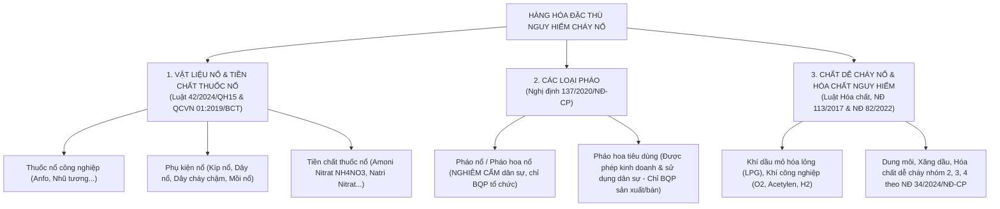
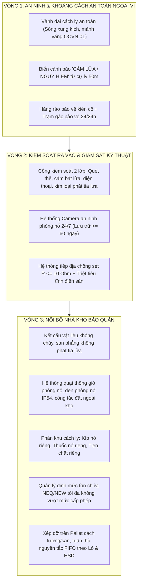

# Báo cáo Khảo sát Thị trường & Quy chuẩn Vận hành Kho bãi, Kinh doanh & Vận chuyển Sản phẩm Đặc thù: Chất gây cháy nổ, Vật liệu nổ & Pháo

- **Mã tài liệu đề xuất đăng ký:** `REF-MKT-005`
- **Dự án:** `QLCH` — Hệ thống Quản lý Chuỗi Bán lẻ, Kho bãi (`WMS`) & Vận chuyển (`TMS`)
- **Mã công việc:** Nghiên cứu Chuyên sâu bổ sung theo lệnh Chủ dự án (`2026-11-14`)
- **Vai trò thực hiện:** `Marketing Lead` (Tuân thủ nghiêm ngặt chuẩn `3.DOC_AI/skills/marketing-research/SKILL.md` và `RULES_CORE.md`)
- **Ngày thu thập & hoàn thành:** `2026-11-14`
- **Người nhận bàn giao:** `BA Lead` (để thực hiện phân tích nghiệp vụ chuyên sâu, mô hình hóa quy trình và thiết kế `SRS/BRD` cho hệ thống quản lý sản phẩm đặc thù)

> **Tuyên bố bảo đảm tính trung thực & Pháp lý (`Reporting Integrity`):**
> Tài liệu này được xây dựng hoàn toàn dựa trên các văn bản quy phạm pháp luật hiện hành của Nhà nước Việt Nam, quy chuẩn kỹ thuật quốc gia (`QCVN`), thông tư chuyên ngành và thông tin công bố chính thức từ các cơ quan quản lý nhà nước (Bộ Quốc phòng, Bộ Công an, Bộ Công Thương, Bộ Xây dựng). **Tuyệt đối không tự suy diễn, không đưa ra các số liệu phỏng đoán hay giả định thiếu căn cứ thực tế.**

---

## 1. Căn cứ Pháp lý Xác thực & Thẩm quyền Quản lý Nhà nước

| STT | Văn bản pháp quy / Quy chuẩn | Trích yếu nội dung & Phạm vi điều chỉnh | Cơ quan ban hành & Thẩm quyền liên quan |
| :---: | :--- | :--- | :--- |
| **1** | **Luật số 42/2024/QH15** *(thay thế Luật số 14/2017/QH14, có hiệu lực từ `01/01/2025`)* | **Luật Quản lý, sử dụng vũ khí, vật liệu nổ và công cụ hỗ trợ:** Quy định nguyên tắc sản xuất, kinh doanh, bảo quản, vận chuyển, xuất khẩu, nhập khẩu và sử dụng vật liệu nổ, tiền chất thuốc nổ. | Quốc hội; Quản lý: **Bộ Công Thương** (VLNCN), **Bộ Quốc phòng**, **Bộ Công an**. |
| **2** | **Nghị định 137/2020/NĐ-CP** *(sửa đổi, bổ sung bởi Nghị định 56/2023/NĐ-CP)* | **Nghị định về quản lý, sử dụng pháo:** Phân định rõ pháo nổ, pháo hoa nổ và pháo hoa; quy định độc quyền sản xuất, kinh doanh pháo hoa; điều kiện kho bãi, bảo quản và vận chuyển pháo hoa. | Chính phủ; Thẩm quyền: **Bộ Quốc phòng**, **Bộ Công an (C06, PC06)**. |
| **3** | **Nghị định 34/2024/NĐ-CP** *(ngày 31/03/2024, thay thế NĐ 42/2020/NĐ-CP)* | **Quy định Danh mục hàng hóa nguy hiểm, vận chuyển hàng hóa nguy hiểm bằng phương tiện giao thông cơ giới đường bộ và phương tiện thủy nội địa:** Phân loại Hàng nguy hiểm Loại 1 (Chất nổ và vật phẩm dễ nổ); thẩm quyền, hồ sơ cấp Giấy phép vận chuyển. | Chính phủ; Cấp phép vận chuyển: **Bộ Công an (C07, PC07)**, **Bộ Quốc phòng**. |
| **4** | **Nghị định 96/2016/NĐ-CP** *(sửa đổi, bổ sung bởi Nghị định 56/2023/NĐ-CP)* | **Quy định điều kiện về an ninh, trật tự đối với một số ngành, nghề đầu tư kinh doanh có điều kiện:** Bắt buộc cấp Giấy chứng nhận đủ điều kiện về ANTT đối với kinh doanh vật liệu nổ công nghiệp, tiền chất thuốc nổ và kinh doanh các loại pháo (pháo hoa). | Chính phủ; Cơ quan cấp phép: **Cục Cảnh sát QLHC về TTXH (C06 - Bộ Công an)** hoặc **Phòng PC06 Công an tỉnh**. |
| **5** | **QCVN 01:2019/BCT** *(Thông tư 32/2019/TT-BCT, hiệu lực từ `01/07/2020`)* | **Quy chuẩn kỹ thuật quốc gia về An toàn trong sản xuất, thử nghiệm, nghiệm thu, bảo quản, vận chuyển, sử dụng, tiêu hủy vật liệu nổ công nghiệp và bảo quản tiền chất thuốc nổ:** Quy định khắt khe về khoảng cách an toàn, kết cấu kho, hệ thống thông gió, thiết bị điện phòng nổ, hệ thống chống sét và chống tĩnh điện. | **Bộ Công Thương** (Cục Kỹ thuật an toàn và Môi trường công nghiệp). |
| **6** | **Nghị định 136/2020/NĐ-CP & Nghị định 50/2024/NĐ-CP** | **Quy định chi tiết một số điều và biện pháp thi hành Luật Phòng cháy và chữa cháy:** Quy định về thẩm duyệt thiết kế PCCC, nghiệm thu PCCC đối với kho chứa vật liệu nổ, pháo, chất gây cháy nổ; huấn luyện nghiệp vụ PCCC & CNCH. | Chính phủ; Thẩm quyền: **Cục C07**, **Phòng Cảnh sát PCCC & CNCH (PC07)**. |
| **7** | **Luật Hóa chất 2007 & Nghị định 113/2017/NĐ-CP, Nghị định 82/2022/NĐ-CP** | Quy định về hóa chất sản xuất, kinh doanh có điều kiện; hóa chất hạn chế sản xuất, kinh doanh; hóa chất phải khai báo và tiền chất thuốc nổ (Amoni nitrat $\ge 98,5\%$, Kali nitrat...). | Chính phủ; Quản lý: **Bộ Công Thương** (Cục Hóa chất). |

---

## 2. Phân loại Sản phẩm Đặc thù & Phạm vi Áp dụng Thực tế

Theo quy định pháp luật hiện hành, các sản phẩm đặc thù nguy hiểm được phân nhóm quản lý rạch ròi với mức độ kiểm soát khác nhau:

### 2.1. Nhóm 1: Vật liệu nổ công nghiệp (VLNCN) & Tiền chất thuốc nổ
- **Đặc tính:** Có khả năng sinh ra phản ứng hóa học cực nhanh, tỏa nhiệt lượng và áp suất cực lớn gây phá hủy công trình.
- **Quy tắc bất biến:** Kíp nổ và phụ kiện kích nổ **tuyệt đối không được bảo quản chung buồng/chung phương tiện vận chuyển với thuốc nổ** (trừ kho thiết kế buồng riêng cách ly đã thẩm duyệt).

### 2.2. Nhóm 2: Các loại Pháo (Quy định tại Nghị định `137/2020/NĐ-CP`)
- **Pháo nổ & Pháo hoa nổ:** Gây tiếng nổ mạnh, có chứa thuốc nổ/thuốc pháo nổ; **nghiêm cấm tuyệt đối tổ chức, cá nhân tự ý sản xuất, mua bán, tàng trữ, vận chuyển, sử dụng** (trừ các trường hợp bắn pháo hoa nổ do Thủ tướng Chính phủ cho phép vào dịp lễ, tết do Bộ Quốc phòng thực hiện).
- **Pháo hoa (Pháo hoa tiêu dùng):** Sản phẩm có chứa thuốc pháo hoa, khi đốt chỉ phát ra hiệu ứng âm thanh (tiếng rít, tiếng huýt), ánh sáng, màu sắc trong không gian, **không gây ra tiếng nổ**. Đây là loại duy nhất cơ quan, tổ chức, cá nhân được phép mua và sử dụng hợp pháp.
- **Đặc quyền phân phối:** **Chỉ các tổ chức, doanh nghiệp trực thuộc Bộ Quốc phòng** mới được phép nghiên cứu, sản xuất, xuất khẩu, nhập khẩu, cung cấp, kinh doanh pháo hoa (Doanh nghiệp tiêu biểu duy nhất tại VN hiện nay: **Công ty TNHH MTV Hóa chất 21 — Nhà máy Z121 / Tổng cục Công nghiệp Quốc phòng**). Các cửa hàng bán pháo hoa trên toàn quốc đều là **Cửa hàng giới thiệu và bán sản phẩm của Công ty Hóa chất 21 (Z121)** được Bộ Quốc phòng và Công an tỉnh phê duyệt.

### 2.3. Nhóm 3: Chất gây cháy nổ, Khí gas hóa lỏng & Hóa chất nguy hiểm
- Xếp vào nhóm Hàng nguy hiểm Loại 2 (Khí nén, khí hóa lỏng), Loại 3 (Chất lỏng dễ cháy), Loại 4 (Chất rắn dễ cháy). Chịu sự điều chỉnh của Luật Hóa chất và các quy chuẩn an toàn kho hóa chất.

---

## 3. Ma trận Quy định Đăng ký, Giấy phép, Giấy Chứng nhận (GCN) & Chứng chỉ (CC) Bắt buộc (Phạm vi Thương mại - Kho bãi - Vận chuyển)

> [!IMPORTANT]
> **Xác định ranh giới phạm vi nghiệp vụ (Scope Boundaries):**
> Theo yêu cầu của Chủ dự án, hệ thống phần mềm phục vụ **hoạt động Thương mại phân phối, Bán lẻ (POS), Vận hành lưu kho (WMS) và Vận chuyển hàng nguy hiểm (TMS)**, **HOÀN TOÀN KHÔNG CÓ KHÂU SẢN XUẤT HAY DỊCH VỤ THI CÔNG NỔ MÌN**.
> Do đó, danh mục pháp lý dưới đây đã được chuẩn hóa và loại bỏ:
> 1. *Loại bỏ Giấy phép sản xuất pháo hoa / VLNCN* (chỉ giữ lại Giấy phép kinh doanh thương mại và văn bản chấp thuận điểm bán lẻ).
> 2. *Loại bỏ Giấy phép sử dụng VLNCN / Chứng chỉ thợ nổ mìn / Chỉ huy nổ mìn* (vì thuộc khâu khai thác mỏ/thi công công trình nổ mìn của khách hàng, không thuộc phạm vi doanh nghiệp thương mại).
> 
> Chuỗi pháp lý chuẩn mực gồm **16 loại Giấy phép, Giấy Chứng nhận và Chứng chỉ chuyên ngành** như sau:

| STT | Tên Giấy phép / GCN / Chứng chỉ | Căn cứ pháp lý | Cơ quan có thẩm quyền cấp | Đối tượng / Khâu áp dụng | Thời hạn hiệu lực |
| :---: | :--- | :--- | :--- | :--- | :--- |
| **I** | **NHÓM GIẤY PHÉP DOANH NGHIỆP & ĐIỀU KIỆN AN NINH TRẬT TỰ** | | | | |
| 1 | **Giấy chứng nhận đăng ký doanh nghiệp** | Luật Doanh nghiệp 2020 | Sở Kế hoạch và Đầu tư tỉnh/thành phố | Doanh nghiệp phân phối, kinh doanh thương mại, dịch vụ kho bãi & vận tải hàng nguy hiểm | Vô thời hạn (theo hoạt động DN) |
| 2 | **Giấy chứng nhận đủ điều kiện về An ninh, Trật tự (ANTT)** | Nghị định `96/2016/NĐ-CP` & NĐ `56/2023/NĐ-CP` | • **Cục C06 - Bộ Công an** (Doanh nghiệp kinh doanh VLNCN, kinh doanh tiền chất thuốc nổ; đầu mối phân phối pháo hoa) • **Phòng PC06 Công an tỉnh** (Kho bảo quản thương mại, Chi nhánh kinh doanh, Cửa hàng bán lẻ pháo hoa Z121) | Toàn bộ trụ sở thương mại, hệ thống kho bãi lưu trữ, điểm bán lẻ | Thường không thời hạn (hoặc cấp theo thời hạn của giấy phép kinh doanh chuyên ngành) |
| 3 | **Phương án bảo đảm An ninh, Trật tự cơ sở** | Điều 8 Nghị định `96/2016/NĐ-CP` | Doanh nghiệp lập, gửi kèm hồ sơ cấp Giấy phép ANTT | Trụ sở, cụm kho bãi thương mại, điểm bán lẻ và phương tiện vận chuyển | Định kỳ rà soát hoặc khi có thay đổi phương án |
| **II** | **NHÓM GIẤY PHÉP PHÒNG CHÁY, CHỮA CHÁY & BẢO VỆ MÔI TRƯỜNG KHO / CỬA HÀNG** | | | | |
| 4 | **Giấy chứng nhận thẩm duyệt thiết kế về PCCC** | NĐ `136/2020/NĐ-CP` & NĐ `50/2024/NĐ-CP` | Cục C07 hoặc Phòng PC07 Công an cấp tỉnh | Trước khi xây dựng, cải tạo kho bãi lưu trữ hàng hóa đặc thù, cửa hàng giới thiệu & bán sản phẩm | Theo công trình thiết kế |
| 5 | **Văn bản chấp thuận kết quả nghiệm thu về PCCC** | Điều 15 NĐ `136/2020/NĐ-CP` & NĐ `50/2024/NĐ-CP` | Cục C07 hoặc Phòng PC07 Công an cấp tỉnh | Điều kiện tiên quyết trước khi đưa kho hàng, cửa hàng bán lẻ vào vận hành thực tế | Theo niên hạn công trình |
| 6 | **Giấy phép môi trường / Đăng ký môi trường** | Luật Bảo vệ môi trường 2020 | Sở TN&MT hoặc UBND cấp huyện/tỉnh | Áp dụng cho các tổng kho thương mại lưu trữ hóa chất, kho tiền chất, vật liệu nổ công nghiệp | `05 – 10 năm` tùy quy mô dung tích kho |
| **III** | **NHÓM GIẤY PHÉP CHUYÊN NGÀNH THƯƠNG MẠI & LƯU KHO PHÁO HOA / VLNCN** | | | | |
| 7 | **Giấy phép kinh doanh Pháo hoa** *(không bao gồm sản xuất)* | Điều 14 Nghị định `137/2020/NĐ-CP` | Bộ Quốc phòng (chỉ cấp cho tổ chức, DN thuộc BQP phân phối thương mại) | Doanh nghiệp kinh doanh thương mại, hệ thống chi nhánh phân phối pháo hoa Z121 | Theo quyết định thành lập / giấy phép kinh doanh |
| 8 | **Văn bản chấp thuận địa điểm Cửa hàng bán lẻ pháo hoa** | NĐ `137/2020/NĐ-CP` & quy định BQP / Công an | Công an tỉnh/thành phố và Công ty Hóa chất 21 (Z121) thẩm duyệt | Từng địa điểm mở Cửa hàng giới thiệu & bán lẻ pháo hoa trực tiếp tới người tiêu dùng | Cấp theo từng năm / từng địa điểm kinh doanh |
| 9 | **Giấy phép kinh doanh Vật liệu nổ công nghiệp / Tiền chất thuốc nổ** *(không bao gồm sản xuất/nổ mìn)* | Điều 37 Luật `42/2024/QH15` | Bộ Công Thương (Cục ATMT) hoặc UBND cấp tỉnh (Sở Công Thương) | Doanh nghiệp kinh doanh thương mại, phân phối buôn bán VLNCN, tiền chất thuốc nổ | `05 năm` |
| 10 | **Giấy chứng nhận đủ điều kiện kho bảo quản VLNCN / Tiền chất thuốc nổ** | QCVN `01:2019/BCT` & Điều 41 Luật `42/2024/QH15` | Sở Công Thương cấp tỉnh chủ trì kiểm tra liên ngành | Từng kho thương mại trung chuyển / lưu kho phân phối của doanh nghiệp | Theo thời hạn kiểm định kỹ thuật an toàn kho |
| **IV** | **NHÓM GIẤY PHÉP VẬN CHUYỂN HÀNG NGUY HIỂM CHÁY NỔ (LOGISTICS / TMS)** | | | | |
| 11 | **Giấy phép vận chuyển Pháo hoa** | Điều 16 Nghị định `137/2020/NĐ-CP` | **Cục Cảnh sát QLHC về TTXH (C06 - Bộ Công an)** | Từng chuyến hàng vận chuyển pháo hoa thương mại từ kho tổng điều chuyển về cửa hàng | **Chỉ có giá trị cho 01 lượt**, thời hạn $\le 07$ ngày (phải nộp lại trong 7 ngày) |
| 12 | **Giấy phép vận chuyển Hàng hóa nguy hiểm Loại 1 (Chất nổ)** | Nghị định `34/2024/NĐ-CP` (Điều 17, 18) | **Bộ Công an (Cục C07 hoặc Phòng PC07 Công an tỉnh)** | Phương tiện xe tải chuyên dụng vận chuyển VLNCN, pháo, chất nổ trên mạng lưới giao thông | Cấp theo từng chuyến hoặc theo thời hạn hợp đồng (tối đa $\le 24$ tháng) |
| 13 | **Giấy chứng nhận kiểm định ATKT & BVMT xe chở hàng nguy hiểm** | Nghị định `34/2024/NĐ-CP` & NĐ `136/2020/NĐ-CP` | Cục Đăng kiểm VN phối hợp Cảnh sát PCCC kiểm định | Xe cơ giới chuyên dụng chở hàng Loại 1 (thùng kín, xích tiếp địa, thiết bị PCCC) | `06 – 12 tháng` theo chu kỳ đăng kiểm |
| **V** | **NHÓM CHỨNG NHẬN, CHỨNG CHỈ (CC) HUẤN LUYỆN CON NGƯỜI (KHO, BÁN LẺ & VẬN TẢI)** | | | | |
| 14 | **Chứng nhận huấn luyện nghiệp vụ PCCC & CNCH** | Nghị định `136/2020/NĐ-CP` (Điều 33) | Phòng PC07 hoặc Công an cấp quận/huyện | Thủ kho, nhân viên bán hàng POS, thủ kho/bốc xếp, lái xe tải chuyên dụng, người áp tải | `05 năm` |
| 15 | **Giấy chứng nhận huấn luyện kỹ thuật an toàn VLNCN / Tiền chất thuốc nổ** | Điều 44 Luật `42/2024/QH15` & QCVN `01:2019/BCT` | Sở Công Thương cấp tỉnh hoặc tổ chức đào tạo được chỉ định | Người quản lý kinh doanh, thủ kho bảo quản thương mại, nhân viên bốc xếp/giao nhận kho | `02 năm` |
| 16 | **Giấy chứng nhận tập huấn an toàn vận chuyển hàng nguy hiểm** | Nghị định `34/2024/NĐ-CP` (Điều 11) | Cơ quan chức năng hoặc đơn vị đào tạo được ủy quyền | Lái xe tải chuyên trách và người áp tải hàng nguy hiểm tham gia điều phối TMS | `02 năm` |

---

## 4. Đánh giá Mô hình Kinh doanh (Business Model) Thực tế tại Việt Nam

### 4.1. Đối với Sản phẩm Pháo hoa (Nghị định `137/2020/NĐ-CP`)
1. **Mô hình Doanh nghiệp Độc quyền Nhà nước / Quốc phòng:**
   - Tại Việt Nam, **Nhà máy Z121 (Công ty TNHH MTV Hóa chất 21 - Tổng cục Công nghiệp Quốc phòng)** là đơn vị độc quyền sản xuất và phân phối các loại pháo hoa dân dụng (giàn phun viên, giàn phun hoa, giàn nhấp nháy, ống phun nước bạc, cây hoa lửa...).
   - **Mạng lưới Cửa hàng Ủy quyền (Authorized Retail Stores):**
     - Mô hình phân phối hoạt động theo chuỗi Cửa hàng giới thiệu và bán sản phẩm pháo hoa Z121 gắn mã định danh theo tỉnh/thành (ví dụ: *Cửa hàng Pháo hoa số 01 - Hà Nội*, *Cửa hàng Pháo hoa số 05 - TP.HCM*...).
     - Mỗi cửa hàng ủy quyền phải được Công an tỉnh phê duyệt địa điểm, kiểm tra an toàn PCCC, cấp Giấy chứng nhận ANTT và niêm yết công khai bảng giá do Nhà máy Z121 ấn định.
2. **Quy định đối với Khách hàng mua pháo hoa:**
   - Người mua phải đủ 18 tuổi, có năng lực hành vi dân sự đầy đủ, xuất trình CCCD chính chủ.
   - Khi xuất bán, cửa hàng phải xuất **Hóa đơn bán hàng / Phiếu thu có đầy đủ thông tin người mua (Họ tên, Số CCCD, Địa chỉ)** để làm căn cứ lưu thông và sử dụng hợp pháp khi cơ quan chức năng kiểm tra (tránh bị nhầm với tàng trữ pháo nổ nhập lậu).

### 4.2. Đối với Vật liệu nổ công nghiệp & Tiền chất thuốc nổ
1. **Mô hình Khách hàng Doanh nghiệp (B2B khép kín):**
   - Không có mô hình bán lẻ tự do cho người dân. 100% khách hàng là doanh nghiệp khai thác khoáng sản (than, đá, quặng), doanh nghiệp xây dựng công trình ngầm, thủy điện, giao thông có **Giấy phép sử dụng VLNCN** hoặc dịch vụ nổ mìn được cấp phép.
   - Doanh số và khối lượng giao dịch được kiểm soát theo định mức nổ mìn đã được cơ quan nhà nước phê duyệt trên hồ sơ cấp phép.
2. **Chuỗi cung ứng chuyên biệt:**
   - Các đơn vị đầu mối lớn (như Tổng công ty Hóa chất mỏ - Vinacomin MICCO) cung ứng theo hình thức giao hàng trực tiếp tại kho hoặc dịch vụ nổ mìn trọn gói đến bãi mìn của khách hàng.

---

## 5. Đánh giá Mô hình Vận hành Kho bãi Sản phẩm Đặc thù (`Warehouse Operations — WMS`)

Kho bảo quản chất gây cháy nổ, vật liệu nổ và pháo hoa không vận hành như kho hàng tiêu dùng thông thường mà phải tuân thủ nghiêm ngặt **QCVN `01:2019/BCT`** và tiêu chuẩn PCCC:

### 5.1. Quy chuẩn Kỹ thuật Kho bãi bắt buộc (Căn cứ QCVN `01:2019/BCT` & PCCC)
1. **Khoảng cách an toàn chống nổ lan:**
   - Kho phải nằm cách biệt khu dân cư, đường dây điện cao thế (tối thiểu cách xa hành lang lưới điện $30\text{ m}$), trường học, bệnh viện theo bán kính tính toán sóng xung kích và mảnh văng quy định tại Phụ lục QCVN `01:2019/BCT`.
   - Có ụ đất hoặc tường chắn nổ bao quanh để định hướng lực nổ lên trên nếu xảy ra sự cố.
2. **Kết cấu chống phát sinh tia lửa & Hệ thống điện phòng nổ:**
   - **Sàn kho:** Bằng phẳng, không đọng nước, được phủ lớp vật liệu **chống tĩnh điện và không phát sinh tia lửa** khi va quẹt kim loại (như bê tông rải phụ gia phi kim loại hoặc sơn epoxy chống tĩnh điện).
   - **Thiết bị điện:** 100% đèn chiếu sáng, công tắc, quạt thông gió trong kho phải đạt chuẩn **phòng nổ chuyên dụng (Ex-proof, cấp bảo vệ tối thiểu IP54)**; tủ điện và cầu dao ngắt nguồn bắt buộc đặt ở **bên ngoài tường kho**.
3. **Chống sét và Cân bằng Tĩnh điện:**
   - Hệ thống chống sét trực tiếp và chống sét lan truyền định kỳ đo kiểm tra; điện trở nối đất bắt buộc $R \le 10\ \Omega$.
   - Tại cửa kho có cọc/thanh đồng chạm tay khử tĩnh điện trước khi bước vào kho.
4. **Nguyên tắc Phân khu Cách ly (`Incompatible Storage Separation`):**
   - Thuốc nổ và Kíp nổ/Phụ kiện kích nổ bắt buộc ở 2 kho riêng hoặc 2 buồng độc lập có tường chống nổ ngăn cách.
   - Tiền chất thuốc nổ Amoni nitrat ($NH_4NO_3$) phải để riêng biệt, cách ly hoàn toàn với dầu mỡ, axít, than đá hoặc kim loại kiềm.

### 5.2. Quy trình Vận hành Xuất – Nhập – Tồn trên Phần mềm WMS
- **Quản lý nghiêm ngặt theo Số Lô (`Lot/Batch`), Số Sê-ri (`Serial`), Ngày sản xuất & Hạn sử dụng:**
  - Mỗi thùng/hộp pháo hoa hoặc bao thuốc nổ có mã vạch chứa thông tin: `Mã sản phẩm` + `Số lô` + `Số thùng` + `Ngày SX` + `Nhà máy SX`.
  - Quét mã vạch nhập kho và xuất kho phải đối soát 100% với **Lệnh xuất hàng / Giấy phép vận chuyển**.
- **Kiểm soát Định mức Tồn chứa Tối đa (`Net Explosive Quantity — NEQ / NEW`):**
  - Mỗi kho được cơ quan Công an và Bộ Công Thương duyệt định mức tồn chứa tối đa (tính theo tấn hoặc kg thuốc nổ quy đổi).
  - Phần mềm WMS phải có chức năng **Khóa chặn nhập kho (Hard Lock)** khi tổng lượng thuốc nổ/thuốc pháo của các lô hàng trong kho vượt quá định mức NEQ cấp phép.
- **Sổ theo dõi Xuất Nhập Bất biến (Audit Log):**
  - Mọi thao tác xuất, nhập, điều chuyển, kiểm kê phải lưu vết: Ngày giờ, Số lượng, Loại hàng, Người nhận, Số CCCD, Biển số xe, Số Giấy phép vận chuyển của Công an. Nghiêm cấm xóa hoặc sửa số liệu cũ.

---

## 6. Đánh giá Mô hình Vận chuyển Hàng Nguy hiểm (`Transportation — TMS`)

Vận chuyển chất nổ, pháo hoa và vật liệu nổ là khâu tiềm ẩn nguy cơ cao nhất trong chuỗi cung ứng, chịu sự điều chỉnh của **Nghị định `34/2024/NĐ-CP`** và **Điều 16 Nghị định `137/2020/NĐ-CP`**:

### 6.1. Quy định về Phương tiện Chuyên chở
1. **Tiêu chuẩn xe cơ giới:**
   - Phải là xe tải thùng kín chuyên dụng được Cục Đăng kiểm và Cảnh sát PCCC kiểm định, cấp Giấy chứng nhận kiểm định an toàn kỹ thuật chở hàng nguy hiểm Loại 1.
   - Thùng xe phải lót gỗ hoặc vật liệu không phát sinh tia lửa, có hệ thống thông gió đối lưu, khóa niêm phong kẹp chì.
   - Trang bị xích tiếp địa tiếp xúc liên tục với mặt đường để tiêu tán điện tích tĩnh điện phát sinh do ma sát gió khi xe chạy.
   - Trang bị tối thiểu 02 bình chữa cháy bột (loại $\ge 4\text{ kg}$) hoặc khí $CO_2$, bình dập lửa thùng xe, dụng cụ chèn bánh xe.
2. **Biển cảnh báo nguy hiểm:**
   - Dán biểu trưng nguy hiểm **Loại 1 (Chất nổ - Hình quả lựu đạn nổ)** kích thước tối thiểu $250\text{ mm} \times 250\text{ mm}$ ở hai bên và phía sau xe.
   - Dán biển màu cam ghi mã số UN của hàng hóa theo Phụ lục Nghị định `34/2024/NĐ-CP`.
3. **Giám sát hành trình (GPS & Camera):**
   - Thiết bị GPS hoạt động 24/7 truyền dữ liệu tốc độ, vị trí và hành trình về trung tâm điều hành; cảnh báo khi tài xế chạy quá tốc độ hoặc đi lệch lộ trình cấp phép.

### 6.2. Quy trình Cấp phép & Điều phối Vận chuyển
1. **Cấp Giấy phép Vận chuyển (Cục C06 hoặc Phòng PC07 / PC06 cấp):**
   - Đối với **Pháo hoa**: Giấy phép vận chuyển cấp cho **từng chuyến hàng cụ thể**, thời hạn không quá **07 ngày**. Sau khi giao hàng xong, trong vòng 07 ngày phải nộp lại giấy phép cho cơ quan Công an đã cấp.
   - Đối với **Vật liệu nổ công nghiệp**: Cấp theo từng chuyến hoặc theo thời hạn hợp đồng (tối đa không quá 24 tháng theo Nghị định `34/2024/NĐ-CP`).
2. **Quy tắc di chuyển trên đường:**
   - **Tuyến đường & Khung giờ chỉ định:** Bắt buộc chạy đúng tuyến đường ghi trong giấy phép; tránh đi vào trung tâm đô thị giờ cao điểm; không dừng đỗ xe chở hàng cháy nổ ở nơi đông người, gần trường học, bệnh viện, chợ, cây xăng.
   - **Quy tắc an toàn qua phà, hầm:** Tuyệt đối cấm chở chung hành khách trên cùng một chuyến phà với xe chở chất nổ (phải đi phà riêng hoặc chuyến chuyên trách); không được đi qua các hầm đường bộ nếu không có phương án an toàn đặc biệt được phê duyệt.
   - **Nhân sự trên xe:** Tối thiểu 02 người (01 lái xe + 01 người áp tải) đều phải có Chứng chỉ huấn luyện PCCC và Chứng nhận tập huấn an toàn vận chuyển hàng nguy hiểm.

---

## 7. Khuyến nghị Nghiệp vụ Chuyên sâu & Chuyển giao cho `BA Lead`

Dựa trên toàn bộ kết quả khảo sát thị trường và khung pháp lý thực tế ở trên, `Marketing Lead` tổng kết 6 bài toán nghiệp vụ trọng tâm đề nghị `BA Lead` đưa vào phân tích chuyên sâu và xây dựng mô hình hệ thống:

1. **Phân rã Mô hình Dữ liệu Sản phẩm (`Product Data Model` cho Hàng đặc thù):**
   - Bổ sung các trường bắt buộc vào bảng `Product`: `Mã UN`, `Nhóm nguy hiểm (1.1, 1.3, 1.4...)`, `Hàm lượng thuốc nổ quy đổi (NEQ/NEW trên đơn vị sản phẩm)`, `Nhiệt độ bảo quản tối đa`, `Độ ẩm cho phép`, `Mã Lô/Batch`, `Hạn sử dụng`, `Nhà máy sản xuất (Z121/MICCO...)`.
2. **Thiết kế Cơ chế Kiểm soát Định mức Kho (`NEQ Warehouse Capacity Control`):**
   - Module `WMS` phải tính toán tổng trọng lượng thuốc nổ/thuốc pháo hiện có trong từng Kho/Khu vực theo công thức:
     $$\text{Tổng NEQ hiện tại} = \sum_{i=1}^{n} (\text{Số lượng SP}_i \times \text{Định lượng NEQ}_i)$$
   - Tự động cảnh báo khi đạt $80\%$ định mức và **Khóa chặn nhập kho (Hard Validation)** nếu $\text{Tổng NEQ} > \text{Định mức cấp phép trên Giấy chứng nhận ANTT/PCCC}$.
3. **Phân hệ Quản lý Hồ sơ Pháp lý & Cảnh báo Hạn Giấy phép (`Compliance & License Management`):**
   - Quản lý danh mục Giấy phép/GCN/Chứng chỉ của: Doanh nghiệp, Từng nhà kho, Từng điểm bán, Từng phương tiện xe tải, và Từng nhân sự (Thủ kho, Lái xe, Người áp tải).
   - Tự động cảnh báo trước $30 - 60\text{ ngày}$ khi Giấy chứng nhận ANTT, Nghiệm thu PCCC, Kiểm định xe chở hàng nguy hiểm, hoặc Chứng chỉ PCCC của nhân viên sắp hết hạn.
4. **Quy trình Quản lý Chuyến Vận chuyển Hàng Nguy hiểm (`Dangerous Goods TMS Module`):**
   - Liên kết chặt chẽ mỗi `Phiếu điều chuyển kho liên chi nhánh` hoặc `Đơn xuất hàng` với một **Mã Giấy phép Vận chuyển (C06/PC07 cấp)** kèm ảnh chụp giấy phép, danh tính lái xe, người áp tải và biển số xe đã được kiểm định.
   - Giám sát trạng thái theo thời gian thực: `Chờ nộp hồ sơ xin phép CQT` $\rightarrow$ `Đã có Giấy phép` $\rightarrow$ `Xuất kho / Niêm phong chì` $\rightarrow$ `Đang vận chuyển (GPS tracking)` $\rightarrow$ `Giao hàng thành công & Nộp trả giấy phép trong 7 ngày`.
5. **Quy trình Bán lẻ & Quản lý Thông tin Khách hàng tại Điểm bán Pháo hoa (`POS Special Checkout`):**
   - Tại quầy POS bán pháo hoa, bắt buộc nhập **Họ tên khách hàng, Số CCCD (12 số), Địa chỉ cư trú và Số điện thoại**.
   - Hóa đơn in ra phải có đủ các thông tin trên kèm Mã QR tra cứu hợp pháp để khách hàng xuất trình khi lưu thông trên đường.
6. **Cơ chế Phân quyền Chống Gian lận & Nhật ký Bất biến (`Audit Log & Anti-tamper`):**
   - Mọi thao tác xuất/nhập/điều chỉnh tồn kho hàng đặc thù bắt buộc phải có chữ ký số hoặc xác thực 2 lớp (Mã OTP/PIN của Quản lý kho).
   - Nhật ký hệ thống ghi lại lịch sử bất biến không thể sửa/xóa, sẵn sàng trích xuất báo cáo định kỳ nộp cho Cục C06 Bộ Công an và Sở Công Thương theo quy định.
